# Example 01: Single OCI BaseDB Primary

In this first BaseDB example, we deploy a **single private Oracle Base Database Service system** using **Terraform/OpenTofu**. The deployment includes a child compartment, networking, security groups and an Oracle Linux 9 bastion for SSH and listener checks.

The goal is to understand the module's **`PRIMARY` creation path**: one DB system with a DB Home, database and PDB. This is the foundation for the Data Guard scenarios in examples 02 and 03.

These examples are part of the [FoggyKitchen.com training ecosystem](https://foggykitchen.com/courses/). Each directory is an independent deployment; completing the previous example is not required.

---

## 🧭 Architecture Overview

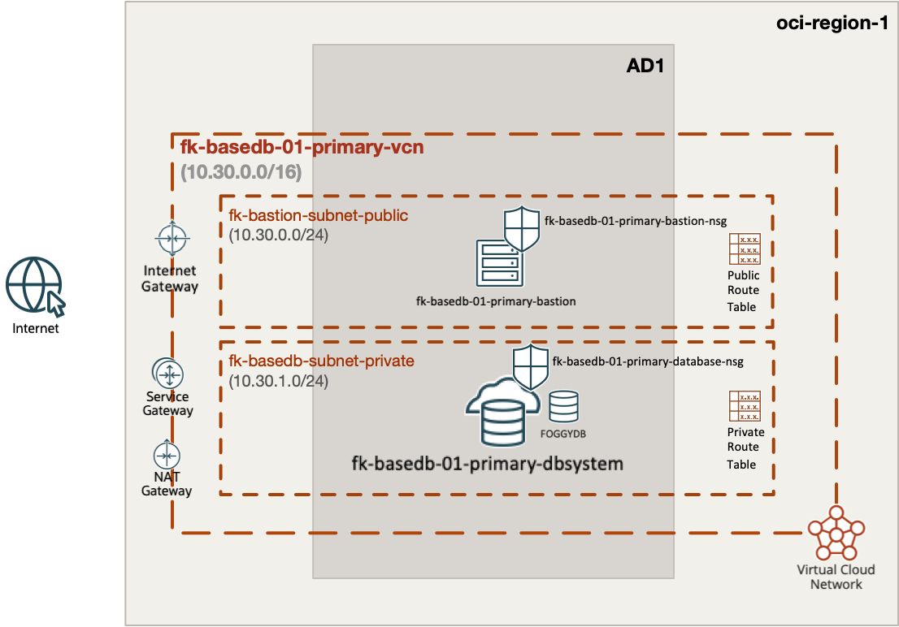

*Figure 1. Single primary BaseDB architecture with a public bastion, private database subnet and supporting network services.*

One VCN (`10.30.0.0/16`) contains a public bastion subnet (`10.30.0.0/24`) and a private database subnet (`10.30.1.0/24`). An Internet Gateway serves the bastion, a NAT Gateway provides private Internet egress, and a Service Gateway carries Oracle Services Network traffic. The database has no public IP.

One BaseDB instance creates the primary DB system, DB Home, database and PDB. The public OL9 bastion is the SSH entry point and a validation host for private listener access.

### Traffic and security

| Source | Destination | Protocol / port | Path |
|---|---|---|---|
| Trusted `admin_cidr` | Bastion | TCP/22 | Internet Gateway |
| Bastion | Database | TCP/22, TCP/1521 | Local VCN |
| Private database | Oracle Services Network | TCP/443 | Service Gateway |
| Private database | Other HTTPS destinations | TCP/443 | NAT Gateway |
| Bastion | Package repositories | TCP/443 | Internet Gateway |

All subnets attach an empty custom Security List and exclude the default Security List. NSGs own the workload permissions. Bastion SSH is limited to the required trusted administrator CIDR; `0.0.0.0/0` is rejected. Database SSH and listener access are limited to the example bastion subnet. ICMP type 3/code 4 permits path MTU discovery. OCI-provided link-local DNS remains the resolver.

NSG rules and routes are separate controls: an open TCP path does not prove database authentication or availability.

---

## 🧩 Module Composition

| Module | Release | Purpose |
|---|---|---|
| `terraform-oci-fk-compartment` | v0.1.1 | Child compartment in the tenancy home region |
| `terraform-oci-fk-vcn` | v0.2.1 | VCN, subnets, route tables, IGW, NAT and SGW |
| `terraform-oci-fk-nsg` | v0.1.0 | Bastion and database security policy |
| `terraform-oci-fk-compute` | v0.2.2 | OL9 bastion, 1 OCPU and 8 GB RAM |
| `terraform-oci-fk-basedb` | local `../..` | Primary DB system, DB Home, database and PDB |

The local BaseDB source supports development before its first release. External consumers should pin a published release when available. All other module sources are pinned to release tags.

---

## 📂 Files by Responsibility

```text
compartment.tf            Child compartment using the home-region provider
providers.tf              OCI regional providers and home-region IAM provider
versions.tf               OpenTofu and provider constraints
datasources.tf            Home-region and availability-domain discovery
locals.tf                 Explicit address plan and placement
network_primary.tf        VCN, subnets, gateways and VCN route tables
nsgs_primary.tf           Bastion and database NSG policy
compute_primary.tf        OL9 bastion / connectivity validation host
tls.tf                    Optional generated lab SSH keypair
dbsystem.tf               BaseDB primary module instance
cloud-init.yaml           Install nmap-ncat on the validation host(s)
variables.tf              Authentication context, placement and database inputs
outputs.tf                IPs, IDs, connection strings and connectivity IDs
terraform.tfvars.example  Input template to copy and customize
tests/                    Offline mocked-provider topology tests
```

Module calls are separated by service. There is no all-in-one `main.tf` in this example.

---

## 📋 Requirements and Costs

Use **OpenTofu >= 1.11.0** and **OCI provider >= 9.12.1, < 10.0.0**. You need OCI API-key/profile or environment authentication, a tenancy, a parent compartment, permissions for IAM/network/compute/database resources, and service quotas. Install Git for module downloads and an SSH client plus `jq` for the runtime checks. The provider uses your local OCI credentials; do not put credentials in committed files. This example creates a new compartment but does not create the tenancy, subscribe regions or grant IAM permissions.

Choose a database version available for the requested shape/edition in the selected region. Database ECPUs, shape, storage and license model are configurable. The default is one DB node per system, VM.BaseDB.x86, 4 ECPUs and 256 GB primary data storage. The database OS is controlled by BaseDB; OL9 settings apply to the bastion only.

The single-primary example selects **Standard Edition**.

BaseDB, bastion compute, NAT and storage incur charges. The compartment is retained on destroy (`enable_delete = false`). Automatic primary backups are disabled by default; SGW routing is available for Oracle services when backup policy is configured separately.

### Current BaseDB provisioning boundary

This example uses VM.BaseDB.x86 with 4 ECPUs, LVM storage and OCI provider 9.12.1. Oracle has [announced retirement of OCPU-metered SKUs and Enterprise Edition Extreme Performance for new provisioning](https://docs.oracle.com/en/cloud/paas/base-database/about/index.html), effective July 31, 2026. Confirm which shapes, editions and billing model your tenancy can provision before a live apply. Passing offline tests does not establish live provisioning availability. All three examples now use ECPU-based VM.BaseDB.x86 systems; review each example’s inputs and recorded deployment results.

---

## ⚙️ Configuration

Copy [terraform.tfvars.example](terraform.tfvars.example) and replace all placeholder values. The example exposes these inputs; additional BaseDB module settings are fixed in the `.tf` files.

| Input | Default | Purpose |
|---|---|---|
| `tenancy_ocid` | **Required** | Tenancy OCID for AD and home-region discovery. |
| `parent_compartment_id` | **Required** | Existing parent compartment or tenancy OCID; a child compartment is created by this example. |
| `name_prefix` | `"fk-basedb-01"` | Unique resource name prefix and child compartment name. |
| `primary_region` | `"eu-frankfurt-1"` | Region in which the primary is created. |
| `primary_availability_domain` | `null` | Optional primary AD override; defaults to the first discovered AD. |
| `admin_cidr` | **Required** | Trusted public IPv4 CIDR allowed to SSH to the bastion, for example your public IP /32. |
| `database_version` | **Required** | Explicit BaseDB version supported by the selected region(s), edition and shape. |
| `admin_password` | **Required** | Sensitive SYS password; supply securely through TF_VAR_admin_password. |
| `ssh_public_keys` | `[]` | Optional public keys; an empty list generates a lab RSA keypair stored in state. |
| `database_shape` | `"VM.BaseDB.x86"` | BaseDB VM shape supported in the selected region(s). |
| `database_ecpus` | `4` | ECPUs per BaseDB system, in multiples of 4. |
| `database_storage_gb` | `256` | Primary data storage size in GB. |
| `license_model` | `"LICENSE_INCLUDED"` | Oracle database license model; review costs and BYOL entitlement. |

The address plan is defined in [locals.tf](locals.tf). Choose a unique `name_prefix` for each deployment. `tenancy_ocid` is used for discovery; it does not configure provider authentication. Configure your OCI profile or environment credentials before running a plan.

---

## 🚀 Deployment Steps

From the repository root:

```sh
cd examples/01_single_primary
cp terraform.tfvars.example terraform.tfvars
# Set tenancy_ocid, parent_compartment_id, your trusted admin_cidr,
# a region-supported database_version, and optionally your SSH public key(s).
# Supply TF_VAR_admin_password securely without committing the password.
tofu init
tofu validate
tofu plan -out=example.tfplan
# Review all billable resources and network/security changes.
tofu apply example.tfplan
```

Run all remaining commands from this example directory. Supply `TF_VAR_admin_password` through your secret manager or a secure local environment before `plan`, `apply` and `destroy`.

When `ssh_public_keys` is empty, the example generates an RSA-4096 SSH keypair using the TLS provider. The private key is a sensitive output and is stored in state; export it only to a protected local file. Supplying public keys disables generation.

No pre-existing subnet, NSG, VCN or deployment compartment OCIDs are required. Protect state and plans because they can contain the SYS password. Bastion cloud-init installs `nmap-ncat` from OL9 BaseOS/AppStream with limited retries. Wait for cloud-init before running listener checks.

---

## 📤 Outputs

After a successful apply, use `tofu output` to inspect the deployment:

| Output | Purpose |
|---|---|
| `compartment_id` | Child compartment OCID. |
| `primary_vcn_id` | Primary VCN OCID. |
| `primary_bastion_public_ip` | Primary bastion public IP for SSH access. |
| `primary_db_system_id` | Primary DB system OCID. |
| `primary_database_id` | Primary database OCID. |
| `primary_private_ips` | Primary database node private IP addresses. |
| `primary_connection_strings` | Primary database connection strings reported by OCI. |

---

## 🖥️ OCI Console and Runtime Verification

Live deployment verified on **2026-11-09** with OCI provider **9.12.1**: DB system and database are **AVAILABLE**, using **VM.BaseDB.x86, 4 ECPUs, 256 GB data storage and LVM**. SQL*Plus reports **Oracle AI Database 26ai Standard Edition 2, 23.26.4.0.0**; `FOGGYDB` is `PRIMARY / READ WRITE` and `FKPDB1` is `READ WRITE`.

The successful DB system creation took **42 minutes 21 seconds**. Earlier attempts exposed the legacy-shape rejection, the LVM requirement and password complexity requirements; these were corrected before successful provisioning. Work Request progress remained at 5% during infrastructure setup and later advanced to 25%; percentages were not a linear time estimate.

Verified: bastion cloud-init completed without errors, TCP/1521 is reachable from the bastion, SSH reaches the private DB node, and local OS-authenticated SQL*Plus queries succeed. Application password authentication over the listener has not been tested. The deployment was destroyed after screenshots and verification on 2026-11-09. The child compartment was retained by design (`enable_delete = false`).

### Recorded test results — 2026-11-09

| Check | Result | Evidence |
|---|---|---|
| DB system creation | PASS | Successful `apply`; creation took 42m21s. |
| OCI lifecycle | PASS | DB system and database both `AVAILABLE`. |
| Bastion initialization | PASS | `cloud-init`: `done`, no errors; `nc` installed. |
| Private database listener | PASS | `nc` from the bastion connected to the private DB IP on TCP/1521. |
| SSH through bastion | PASS | ProxyJump to the private DB node returned hostname `fkprimary`. |
| Database version | PASS | SQL*Plus reported Oracle AI Database 26ai Standard Edition 2, `23.26.4.0.0`. |
| Primary role and open mode | PASS | `FOGGYDB`: `PRIMARY`, `READ WRITE`. |
| Application PDB | PASS | `FKPDB1`: `READ WRITE`; `PDB$SEED`: `READ ONLY`. |
| Final OpenTofu plan | PASS | `No changes. Your infrastructure matches the configuration.` SSH key trailing whitespace is normalized by the module. |
| Offline module/example tests | PASS | 11 root tests plus 7 example tests; no cloud resources created by these tests. |

The SQL session ran on the private DB node reached through the bastion, using `sudo -iu oracle sqlplus -s / as sysdba`. This verifies local OS authentication; it does not claim password-based application authentication through the listener.

SQL*Plus output (column spacing normalized):

```text
Oracle AI Database 26ai Standard Edition 2 Release 23.26.4.0.0 - Production
Version 23.26.4.0.0

NAME      DATABASE_ROLE    OPEN_MODE
FOGGYDB   PRIMARY          READ WRITE

NAME       OPEN_MODE
PDB$SEED   READ ONLY
FKPDB1     READ WRITE
```

### 1. Access and private listener

```sh
umask 077
tofu output -raw ssh_private_key_pem > primary_ssh.pem
ssh_key="$PWD/primary_ssh.pem" # For supplied public keys, use your matching private key instead.
bastion_ip=$(tofu output -raw primary_bastion_public_ip)
primary_db_ip=$(tofu output -json primary_private_ips | jq -r '.[0]')
ssh -i "$ssh_key" opc@"$bastion_ip" 'sudo cloud-init status --wait'
ssh -i "$ssh_key" opc@"$bastion_ip" "nc -vz '$primary_db_ip' 1521"
ssh -i "$ssh_key" -J opc@"$bastion_ip" opc@"$primary_db_ip" hostname
```

A successful `nc` check reports port 1521 open; successful SSH prints the database host name. Keep the private key locally; do not copy it onto the bastion. With multiple local identities, configure the same `IdentityFile` for the jump host in `~/.ssh/config`. If cloud-init fails, inspect its logs and repository access before assuming the network is healthy.

### 2. Database checks

In OCI Console, verify the DB system and database lifecycle states are `AVAILABLE`. Connect through the bastion to a DB node, switch to the `oracle` OS account, select the correct Oracle environment, and open SQL*Plus with local SYSDBA authentication:

```sql
select name, database_role, open_mode from v$database;
select name, open_mode from v$pdbs;
```

The primary should report `PRIMARY` and `READ WRITE`.

For application authentication, use SQLcl/SQL*Plus and the reported connection string, supplying the password interactively. Private IP reachability and SQL login are separate checks.

---

## 📸 OCI Console Screenshots

Captured from the verified example 01 deployment on 2026-11-09. The architecture diagram is shown at the beginning of this guide; the console screenshots record the deployment in Frankfurt AD-3.

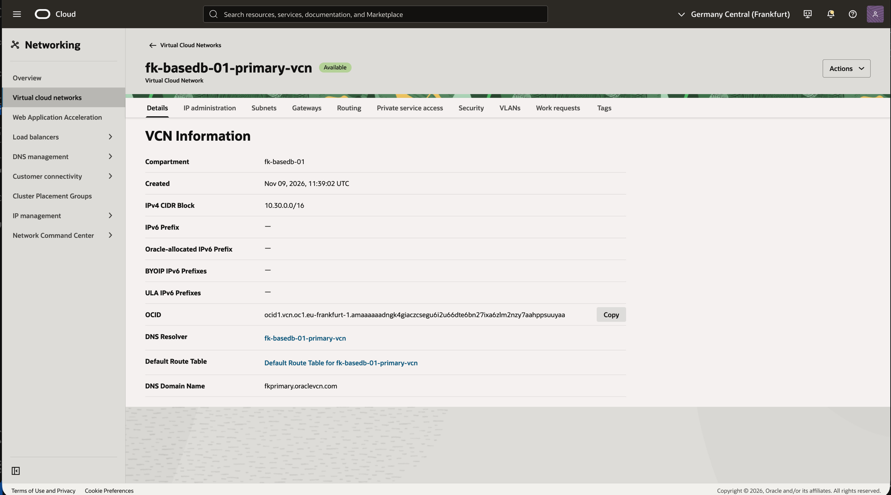

*Figure 2. VCN. The deployed VCN uses 10.30.0.0/16.*

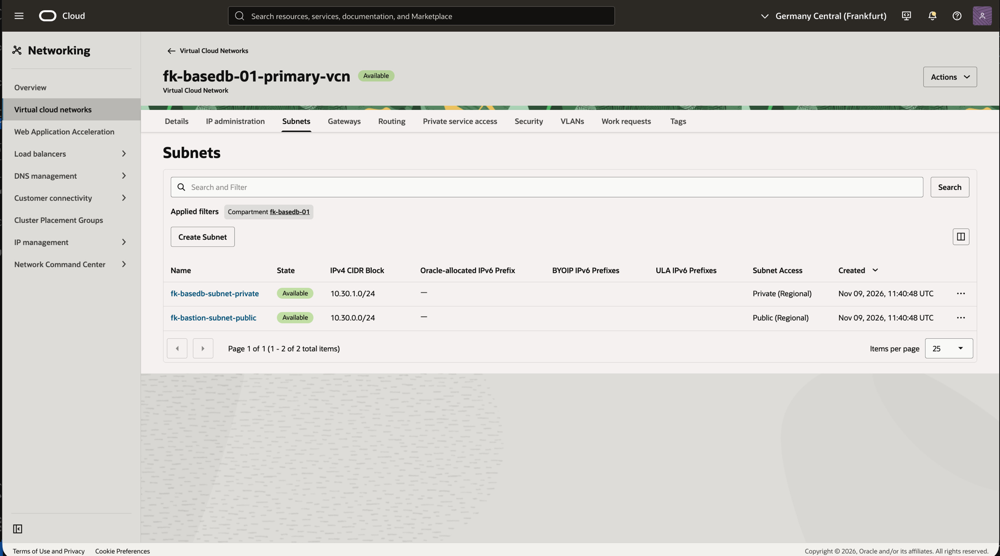

*Figure 3. Subnets. The public bastion subnet and private database subnet are regional.*

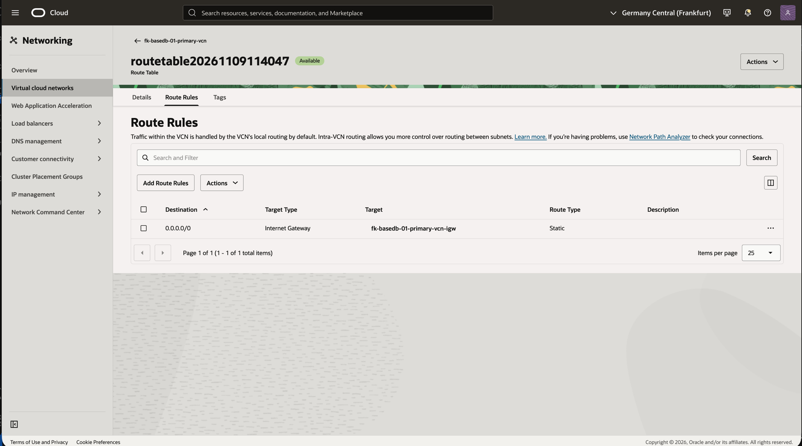

*Figure 4. Public route table. Internet-bound traffic from the public subnet uses the Internet Gateway.*

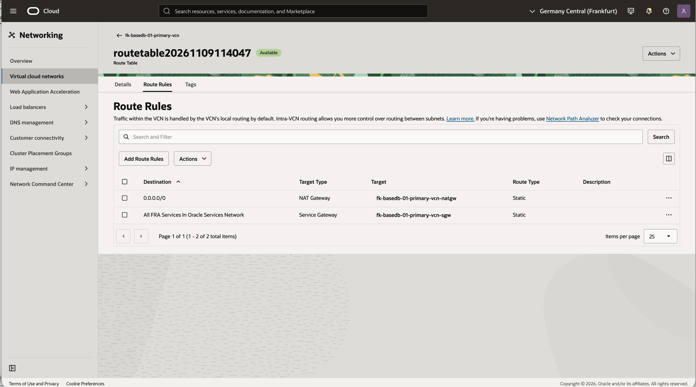

*Figure 5. Private route table. Private subnet routes use the NAT Gateway for Internet egress and the Service Gateway for Oracle Services Network traffic.*

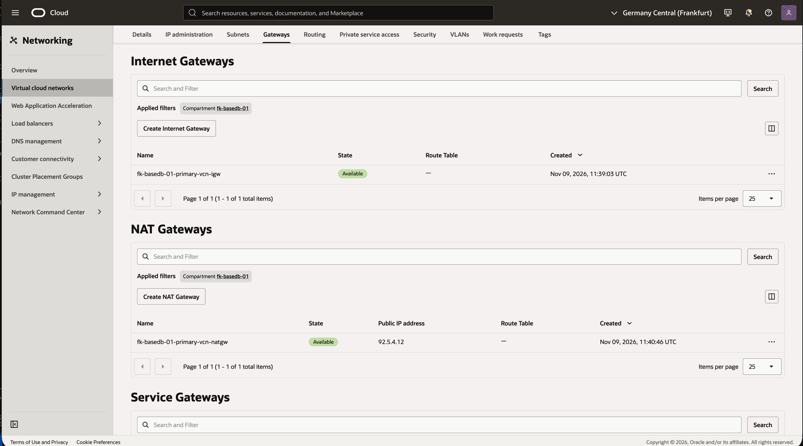

*Figure 6. Internet and NAT gateways. Both gateways are available in the deployment VCN.*

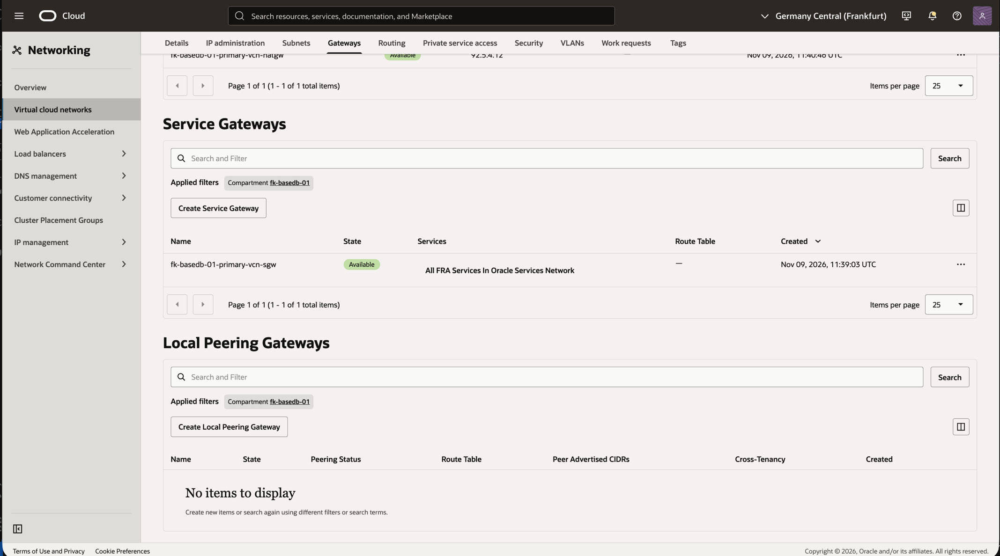

*Figure 7. Service Gateway. The Service Gateway provides access to All FRA Services in Oracle Services Network.*

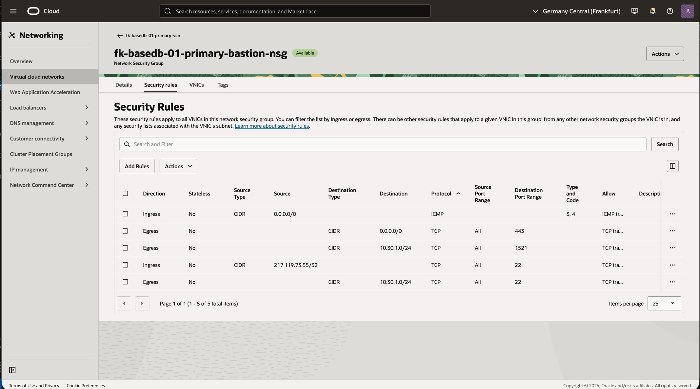

*Figure 8. Bastion NSG. SSH ingress is restricted to the administrator IP; egress allows SSH and SQL access to the database subnet.*

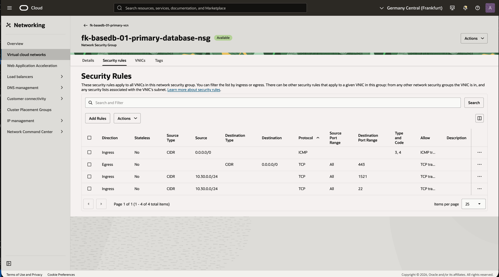

*Figure 9. Database NSG. The database allows SSH and listener traffic from the bastion subnet.*

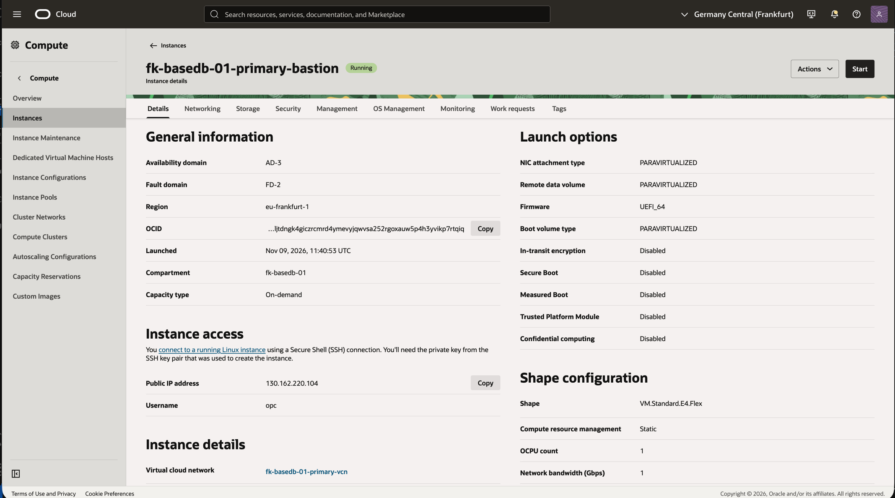

*Figure 10. Bastion instance. The Oracle Linux bastion is running on VM.Standard.E4.Flex with 1 OCPU.*

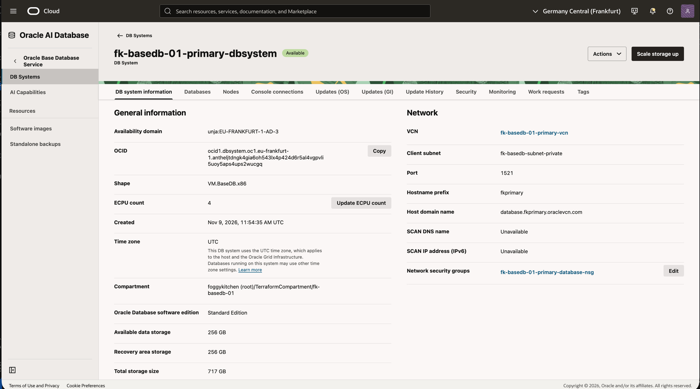

*Figure 11. DB system. The available DB system uses VM.BaseDB.x86 with 4 ECPUs and Standard Edition. Data storage is 256 GB; the console reports 717 GB total storage including recovery and system volumes.*

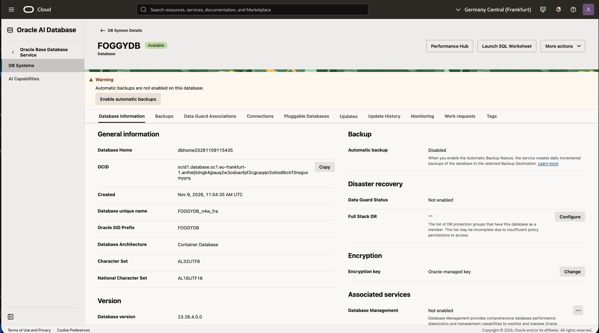

*Figure 12. Database. FOGGYDB is available on version 23.26.4.0.0 (26ai). Automatic backups are disabled for this lab.*

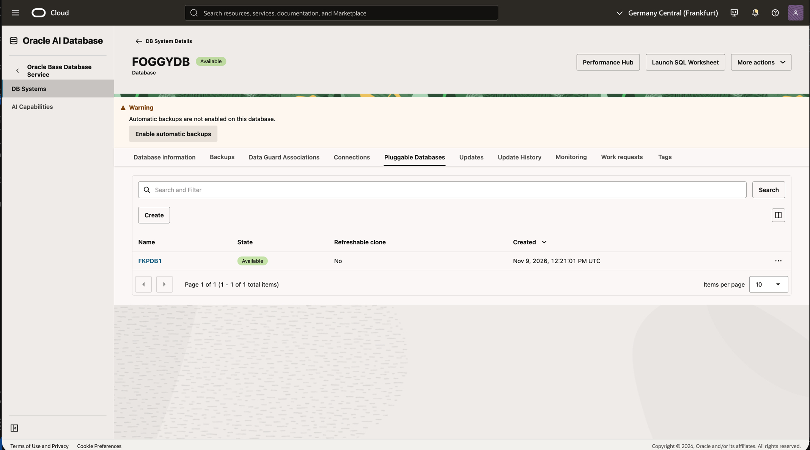

*Figure 13. Pluggable database. FKPDB1 is available; the SQL checks above separately confirmed READ WRITE mode.*

---

## ✅ Offline Validation

```sh
tofu init -backend=false
tofu validate
tofu test
```

Tests mock OCI providers and do not create infrastructure. They check module composition and outputs, including rejection of public SSH. They do not prove OCI regional capacity, network connectivity, licensing or successful database provisioning.

---

## 🧹 Cleanup

```sh
tofu plan -destroy
tofu destroy
```

Cleanup verified on **2026-11-09**: the saved destroy plan completed with **24 resources destroyed** and no managed resources remaining in state. OCI checks found no non-terminated DB systems or compute instances, no VCNs, no remaining block/boot volumes in the deployment scope, and no database or boot-volume backups. The DB system deletion took **18m3s**.

Destroy removes example networking, compute and databases; lab data is deleted. The child compartment remains in OCI because `enable_delete = false`; account for it before a subsequent deployment. Copy required data before cleanup.

---

## 🎓 Learning Outcomes

After working through this example, you can:

- Create a private BaseDB primary with its own network and access infrastructure.
- Use the public bastion to check SSH and the private database listener.
- Distinguish network reachability from database availability and SQL authentication.

---

## 🌐 Learn More

Visit [FoggyKitchen.com](https://foggykitchen.com/) for OCI, multicloud and Terraform/OpenTofu learning resources.

[Next: same-region Data Guard](../02_same_region_data_guard/README.md)

[All BaseDB examples](../README.md) · [Module reference](../../README.md) · [Support](../../SUPPORT.md)

---

## 🪪 License

Licensed under the **Universal Permissive License (UPL), Version 1.0**.
See [LICENSE](../../LICENSE) for details.

---

© 2026 [FoggyKitchen.com](https://foggykitchen.com) - Cloud. Code. Clarity.
