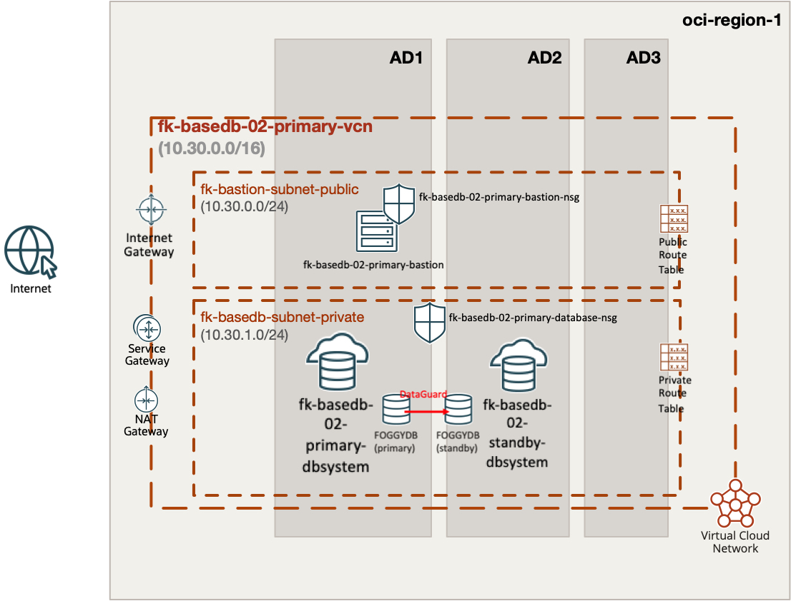
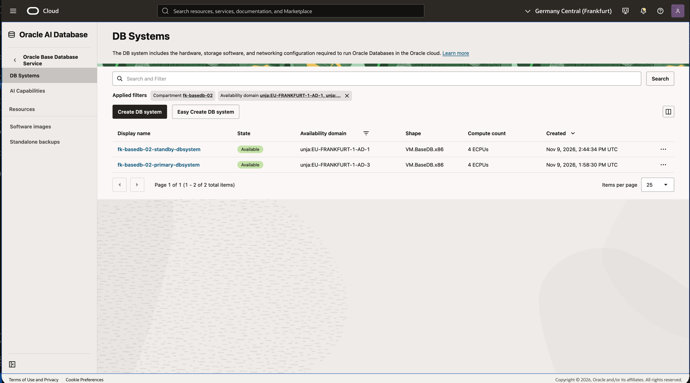
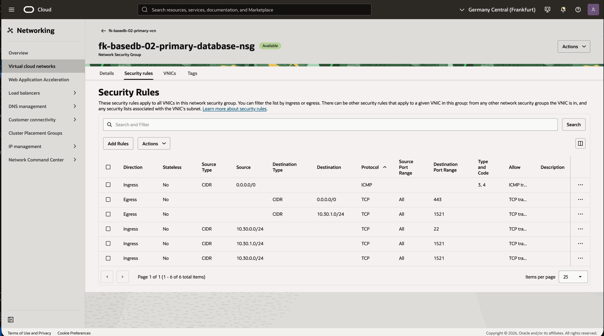
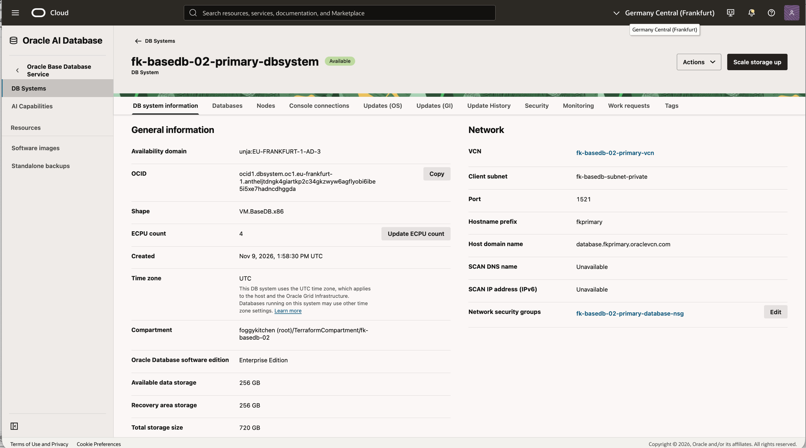
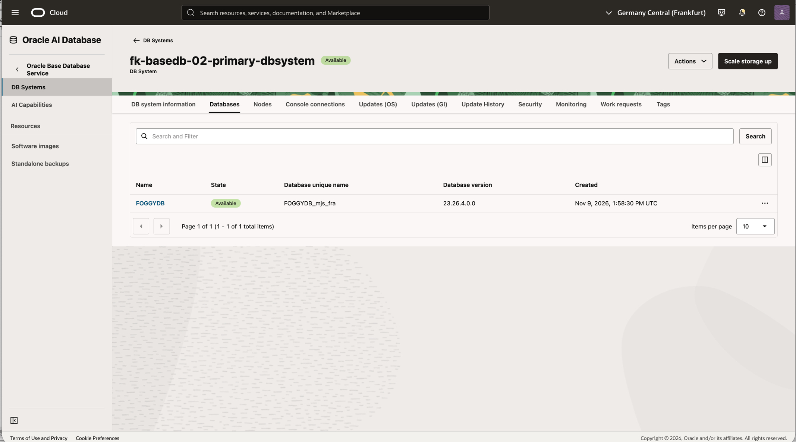
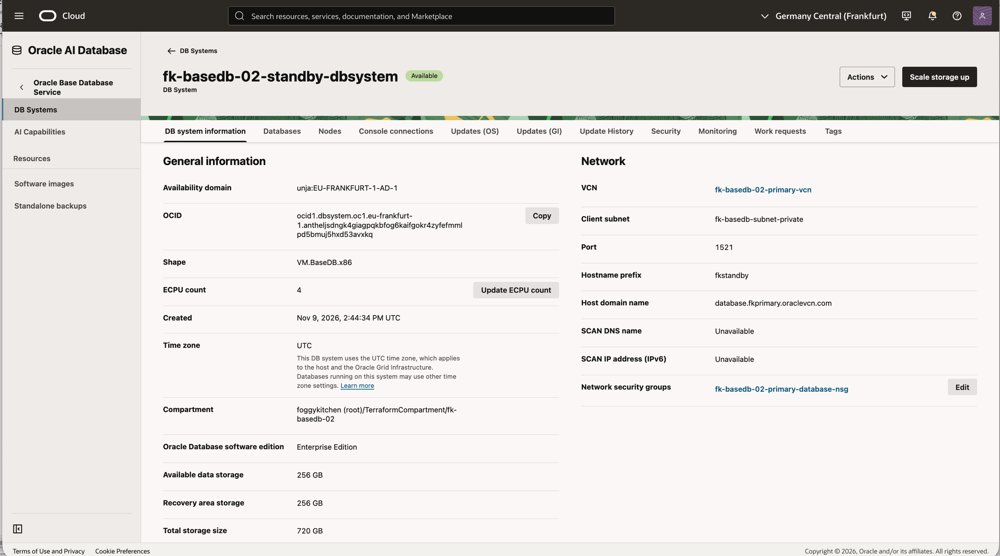
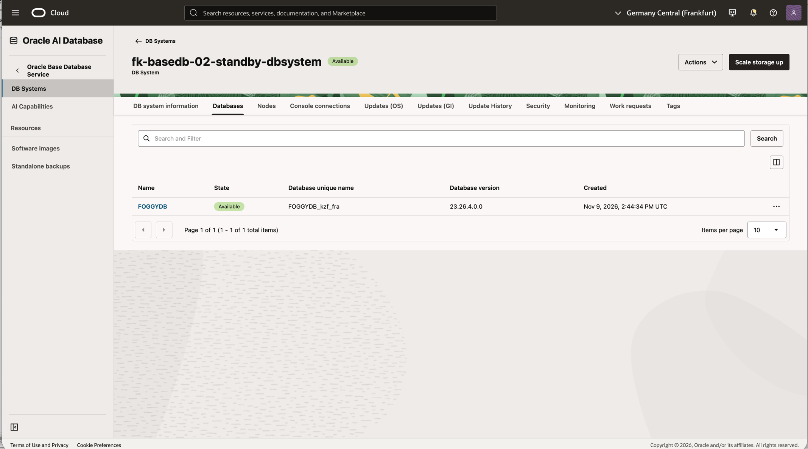
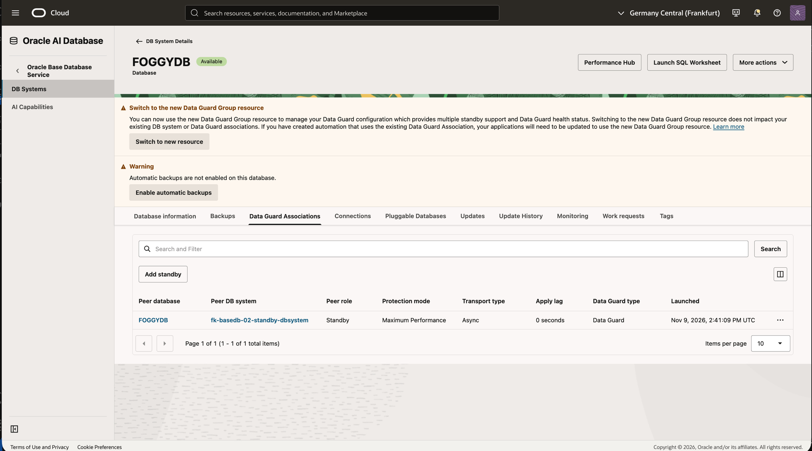

# Example 02: Same-Region OCI BaseDB Data Guard

In this example, we extend the single-primary topology with a **physical Data Guard standby in the same OCI region** using **Terraform/OpenTofu**. Both database systems share a private database subnet and are reached through one Oracle Linux 9 bastion.

The goal is to compose the **`PRIMARY` and `STANDBY` creation paths**, understand availability-domain and fault-domain placement, and verify asynchronous redo replication within one region.

These examples are part of the [FoggyKitchen.com training ecosystem](https://foggykitchen.com/courses/). Each directory is an independent deployment; completing the previous example is not required.

---

## 🧭 Architecture Overview



*Figure 1. Same-region Data Guard architecture with a shared private subnet and database NSG.*

The diagram illustrates primary/bastion in AD1 and standby in AD2, sharing regional subnets. The tested deployment used Frankfurt AD-3 for primary/bastion and AD-1 for standby, as shown in the console screenshots below. Availability-domain labels depend on the selected input values.

One VCN (`10.30.0.0/16`) contains a public bastion subnet (`10.30.0.0/24`) and a private database subnet (`10.30.1.0/24`). An Internet Gateway serves the bastion, a NAT Gateway provides private Internet egress, and a Service Gateway carries Oracle Services Network traffic. The database has no public IP.

Two BaseDB module instances create the primary and a new physical standby in the same regional VCN. The standby association provisions its DB system; the example does not separately create a standby `oci_database_db_system`. Placement uses different ADs where the region has multiple ADs. In a single-AD region, primary FD1 and standby FD2 provide fault-domain separation. You can override the AD inputs explicitly.

### Resource naming

Resource names follow the same convention as example 01. With the default `name_prefix = "fk-basedb-02"`:

| Resource | Name |
|---|---|
| Compartment | `fk-basedb-02` |
| VCN | `fk-basedb-02-primary-vcn` |
| Public bastion subnet | `fk-bastion-subnet-public` |
| Private database subnet | `fk-basedb-subnet-private` |
| Bastion NSG | `fk-basedb-02-primary-bastion-nsg` |
| Shared database NSG | `fk-basedb-02-primary-database-nsg` |
| Bastion instance | `fk-basedb-02-primary-bastion` |
| Primary DB system | `fk-basedb-02-primary-dbsystem` |
| Standby DB system | `fk-basedb-02-standby-dbsystem` |

The standby shares the private subnet and database NSG. The database NSG adds stateful TCP/1521 ingress and egress within the database subnet for Data Guard. Provider authentication, generated lab SSH keys, bastion configuration, gateway setup and subnet settings follow example 01.

### Traffic and security

| Source | Destination | Protocol / port | Path |
|---|---|---|---|
| Trusted `admin_cidr` | Bastion | TCP/22 | Internet Gateway |
| Bastion | Database | TCP/22, TCP/1521 | Local VCN |
| Primary database subnet | Standby database subnet, and reverse | TCP/1521 | Local regional VCN |
| Private database | Oracle Services Network | TCP/443 | Service Gateway |
| Private database | Other HTTPS destinations | TCP/443 | NAT Gateway |
| Bastion | Package repositories | TCP/443 | Internet Gateway |

All subnets attach an empty custom Security List and exclude the default Security List. NSGs own the workload permissions. Bastion SSH is limited to the required trusted administrator CIDR; `0.0.0.0/0` is rejected. Database SSH and listener access are limited to the example bastion subnet. Data Guard adds stateful TCP/1521 ingress and egress between database subnets. ICMP type 3/code 4 permits path MTU discovery. OCI-provided link-local DNS remains the resolver.

The Data Guard rules follow [Oracle BaseDB Data Guard prerequisites](https://docs.oracle.com/en/cloud/paas/base-database/data-guard/). NSG rules and routes are separate controls: an open TCP path does not prove database authentication or healthy redo apply.

---

## 🧩 Module Composition

| Module | Release | Purpose |
|---|---|---|
| `terraform-oci-fk-compartment` | v0.1.1 | Child compartment in the tenancy home region |
| `terraform-oci-fk-vcn` | v0.2.1 | VCN, subnets, route tables, IGW, NAT and SGW |
| `terraform-oci-fk-nsg` | v0.1.0 | Bastion, database and Data Guard security policy |
| `terraform-oci-fk-compute` | v0.2.2 | OL9 bastion, 1 OCPU and 8 GB RAM |
| `terraform-oci-fk-basedb` | local `../..` | Database system and Data Guard creation paths |

The local BaseDB source supports development before its first release. External consumers should pin a published release when available. VCN v0.2.1, compartment v0.1.1 and DRG v0.4.1 support OCI `>= 6.0.0, < 10.0.0`; this example explicitly requires OCI `>= 9.12.1, < 10.0.0`. Local dependency overrides are no longer required. Initialization, validation and a read-only plan passed on 2026-11-12 using the published dependencies and OCI 9.12.1. No apply was run for this dependency verification.

---

## 📂 Files by Responsibility

```text
compartment.tf            Child compartment using the home-region provider
providers.tf              OCI regional providers and home-region IAM provider
versions.tf               OpenTofu and provider constraints
datasources.tf            Home-region and availability-domain discovery
locals.tf                 Explicit address plan and placement
network_primary.tf        VCN, subnets, gateways and VCN route tables
nsgs_primary.tf           Bastion and database NSG policy
compute_primary.tf        OL9 bastion / connectivity validation host
tls.tf                    Optional generated lab SSH keypair
dbsystem.tf               BaseDB primary module instance
dataguard.tf              BaseDB standby module instance
cloud-init.yaml           Install nmap-ncat on the validation host(s)
variables.tf              Authentication context, placement and database inputs
outputs.tf                IPs, IDs, connection strings and connectivity IDs
terraform.tfvars.example  Input template to copy and customize
tests/                    Offline mocked-provider topology tests
```

Module calls are separated by service. There is no all-in-one `main.tf` in this example.

---

## 📋 Requirements and Costs

Use **OpenTofu >= 1.11.0** and **OCI provider >= 9.12.1, < 10.0.0**. You need OCI API-key/profile or environment authentication, a tenancy, a parent compartment, permissions for IAM/network/compute/database resources, and service quotas. Install Git for module downloads and an SSH client plus `jq` for the runtime checks. The provider uses your local OCI credentials; do not put credentials in committed files. This example creates a new compartment but does not create the tenancy, subscribe regions or grant IAM permissions.

Choose a database version available for the requested shape/edition in the selected region. Database ECPUs, shape, storage and license model are configurable. The default is one DB node per system, VM.BaseDB.x86, 4 ECPUs and 256 GB primary data storage. The database OS is controlled by BaseDB; OL9 settings apply to the bastion only.

This Data Guard example selects **Enterprise Edition**. Confirm licensing and capacity for both primary and standby systems. Active Data Guard is disabled.

BaseDB, bastion compute, NAT and storage incur charges. The compartment is retained on destroy (`enable_delete = false`). Automatic primary backups are disabled by default; SGW routing is available for Oracle services when backup policy is configured separately.

### Current BaseDB provisioning boundary

This example uses VM.BaseDB.x86 with 4 ECPUs per DB system and Enterprise Edition. The primary uses LVM; Data Guard creates the standby from the primary configuration. Active Data Guard is disabled. Oracle has [announced retirement of OCPU-metered SKUs and Enterprise Edition Extreme Performance for new provisioning](https://docs.oracle.com/en/cloud/paas/base-database/about/index.html), effective July 31, 2026. Confirm which shapes, editions and billing model your tenancy can provision before a live apply. Passing offline tests does not establish live Data Guard availability. ECPU inputs are configured for both primary and standby with OCI 9.12.1. Live Data Guard deployment was verified on 2026-11-09; see the recorded results below.

---

## ⚙️ Configuration

Copy [terraform.tfvars.example](terraform.tfvars.example) and replace all placeholder values. The example exposes these inputs; additional BaseDB module settings are fixed in the `.tf` files.

| Input | Default | Purpose |
|---|---|---|
| `tenancy_ocid` | **Required** | Tenancy OCID for AD and home-region discovery. |
| `parent_compartment_id` | **Required** | Existing parent compartment or tenancy OCID; a child compartment is created by this example. |
| `name_prefix` | `"fk-basedb-02"` | Unique resource name prefix and child compartment name. |
| `primary_region` | `"eu-frankfurt-1"` | Region in which the primary is created. |
| `primary_availability_domain` | `null` | Optional primary AD override; defaults to the first discovered AD. |
| `admin_cidr` | **Required** | Trusted public IPv4 CIDR allowed to SSH to the bastion, for example your public IP /32. |
| `database_version` | **Required** | Explicit BaseDB version supported by the selected region(s), edition and shape. |
| `admin_password` | **Required** | Database SYS password supplied securely, shared by primary and standby. |
| `ssh_public_keys` | `[]` | Optional public keys; omit to generate a lab RSA keypair stored in state. |
| `database_shape` | `"VM.BaseDB.x86"` | BaseDB VM shape supported in the selected region(s). |
| `database_ecpus` | `4` | ECPUs per primary and standby system. |
| `database_storage_gb` | `256` | Primary data storage GB; standby storage is created by Data Guard. |
| `license_model` | `"LICENSE_INCLUDED"` | Oracle database license model; review costs and BYOL entitlement. |
| `standby_availability_domain` | `null` | Optional standby AD override; defaults to the next AD after the selected primary (or the only AD). |

The address plan is defined in [locals.tf](locals.tf). Choose a unique `name_prefix` for each deployment. `tenancy_ocid` is used for discovery; it does not configure provider authentication. Configure your OCI profile or environment credentials before running a plan.

---

## 🚀 Deployment Steps

From the repository root:

```sh
cd examples/02_same_region_data_guard
cp terraform.tfvars.example terraform.tfvars
# Set tenancy_ocid, parent_compartment_id, your trusted admin_cidr,
# a region-supported database_version, and optionally your SSH public key(s).
# Supply TF_VAR_admin_password securely without committing the password.
tofu init
tofu validate
tofu plan -out=example.tfplan
# Review all billable resources and network/security changes.
tofu apply example.tfplan
```

Run all remaining commands from this example directory. Supply `TF_VAR_admin_password` through your secret manager or a secure local environment before `plan`, `apply` and `destroy`.

No pre-existing subnet, NSG, VCN or deployment compartment OCIDs are required. Protect state and plans because they can contain the SYS password. Bastion cloud-init installs `nmap-ncat` from OL9 BaseOS/AppStream with limited retries. Wait for cloud-init before running listener checks.

---

## 📤 Outputs

After a successful apply, use `tofu output` to inspect the deployment:

| Output | Purpose |
|---|---|
| `compartment_id` | Child compartment OCID. |
| `primary_vcn_id` | Primary VCN OCID. |
| `primary_bastion_public_ip` | Primary bastion public IP for SSH access. |
| `primary_db_system_id` | Primary DB system OCID. |
| `primary_database_id` | Primary database OCID. |
| `primary_private_ips` | Primary database node private IP addresses. |
| `primary_connection_strings` | Primary database connection strings reported by OCI. |
| `standby_db_system_id` | Standby DB system OCID. |
| `standby_database_id` | Standby database OCID. |
| `standby_private_ips` | Standby database node private IP addresses. |
| `standby_connection_strings` | Standby database connection strings reported by OCI. |
| `data_guard_association_id` | Source-side Data Guard association OCID. |

---

## 🖥️ OCI Console and Runtime Verification

Live deployment and runtime checks completed on **2026-11-09**; the environment was subsequently destroyed after verification and screenshots, using OCI **9.12.1**, TLS **4.4.2**, and Oracle AI Database **26ai Enterprise Edition 23.26.4.0.0**. Both systems use **VM.BaseDB.x86, 4 ECPUs and 256 GB data storage**; the console reports 720 GB total storage per system, including recovery and system volumes.

### Recorded test results

| Check | Result | Evidence |
|---|---|---|
| Apply | PASS | 27 resources added, 0 changed, 0 destroyed. |
| Placement and lifecycle | PASS | Primary AD-3 and standby AD-1; both DB systems and databases AVAILABLE. |
| Data Guard configuration | PASS | Both associations AVAILABLE; PRIMARY/STANDBY, ASYNC, MAXIMUM_PERFORMANCE; Active Data Guard disabled. |
| OCI apply lag | PASS | 0 seconds reported on both associations. |
| Bastion initialization | PASS | Cloud-init completed successfully. |
| Private listeners | PASS | TCP/1521 reachable from the bastion on both database nodes. |
| SSH through bastion | PASS | Hostnames fkprimary and fkstandby returned successfully. |
| SQL version | PASS | Both nodes report Oracle AI Database 26ai Enterprise Edition 23.26.4.0.0. |
| Primary role and PDB | PASS | FOGGYDB PRIMARY / READ WRITE; FKPDB1 READ WRITE. |
| Standby role and PDB | PASS | FOGGYDB PHYSICAL STANDBY / MOUNTED; FKPDB1 MOUNTED. |
| SQL replication lag | PASS | Standby v$dataguard_stats: transport lag and apply lag both +00 00:00:00. |
| Post-apply plan | PASS | No changes. Your infrastructure matches the configuration. |
| Offline validation | PASS | tofu validate and format check succeeded; all 3 example composition tests passed. |

SQL checks ran through the bastion using local OS authentication (`sudo -iu oracle sqlplus -s / as sysdba`). Password-based application login, switchover, failover and a dedicated test transaction were not tested. Zero lag is a point-in-time observation.

### Deployment duration and planning estimates

| Operation | Measured duration | Planning allowance |
|---|---|---|
| Primary creation | 42m40s | Included in the total below. |
| Standby and Data Guard creation | 1h4m37s, after primary | Included in the total below. |
| Complete tofu apply | Approximately 1h48m, including networking | Reserve about 2 hours for this lab; capacity and service operations can extend it. |
| Standby / Data Guard deletion | 23m4s | Included in the total below. |
| Primary deletion | 16m41s, after standby | Included in the total below. |
| Complete tofu destroy | **40m3s**, including network cleanup | Reserve 40–60 minutes for this lab; this is a planning allowance, not a guaranteed upper bound. |

These are observations from one deployment, not service guarantees. Work Request percentages were not linear: primary spent about 26 minutes at 5%; standby creation had its own progress indicator inside the longer Data Guard operation. The standby DB system appeared on the resource list about 3–4 minutes after Data Guard creation started. Both systems briefly entered UPDATING during Data Guard configuration. Read the final lifecycle and Work Request status rather than estimating remaining time from percentages.

### Lessons carried forward from example 01

- The shared BaseDB module uses `VM.BaseDB.x86`, ECPU inputs and explicit LVM storage for the primary. It trims SSH public-key whitespace to avoid the drift observed after the first deployment. Standby creation inherits the primary SSH keys and database version.
- Example 01 successfully provisioned version `23.26.4.0.0` (26ai) with OCI 9.12.1. Example 02 uses that version with Enterprise Edition and 4 ECPUs per system; live Data Guard creation and runtime checks succeeded as recorded above.
- The successful lab password used 12–30 characters with at least two uppercase letters, lowercase letters, digits and special characters. Use a comparably strong password for both systems. The module validates length only; OCI performs the remaining complexity checks.
- Primary creation in example 01 took **42m21s**, with prolonged work-request progress at 5% and then 25%. Those percentages were not a linear time estimate. Example 02 creates the standby after the primary, so the example 01 duration is not an estimate for the complete pair.
- Wait for bastion cloud-init before listener checks. Verify SSH, TCP/1521, local SQL authentication and Data Guard health separately; listener reachability alone does not prove SQL authentication or redo apply.
- Example 01 deletion took **18m3s** for the DB system. Its compartment was retained by design; example 02 uses the same retention setting. Verify remaining resources after cleanup.

The live `tofu plan` on **2026-11-09** succeeded with **27 to add, 0 to change, 0 to destroy**, using local module overrides at the time. It selected Frankfurt **AD-3** for primary/bastion and **AD-1** for standby. The subsequent apply and runtime checks succeeded as recorded above.

### 1. Access and private listener

```sh
umask 077
tofu output -raw ssh_private_key_pem > primary_ssh.pem
ssh_key="$PWD/primary_ssh.pem" # With supplied public keys, use the matching private key.
bastion_ip=$(tofu output -raw primary_bastion_public_ip)
primary_db_ip=$(tofu output -json primary_private_ips | jq -r '.[0]')
ssh -i "$ssh_key" opc@"$bastion_ip" 'sudo cloud-init status --wait'
ssh -i "$ssh_key" opc@"$bastion_ip" "nc -vz '$primary_db_ip' 1521"
ssh -i "$ssh_key" -J opc@"$bastion_ip" opc@"$primary_db_ip" hostname
```

A successful `nc` check reports port 1521 open; successful SSH prints the database host name. Keep the private key locally; do not copy it onto the bastion. With multiple local identities, configure the same `IdentityFile` for the jump host in `~/.ssh/config`. If cloud-init fails, inspect its logs and repository access before assuming the network is healthy.

### 2. Standby listener

```sh
standby_db_ip=$(tofu output -json standby_private_ips | jq -r '.[0]')
ssh -i "$ssh_key" opc@"$bastion_ip" "nc -vz '$standby_db_ip' 1521"
```

### 3. Database checks

In OCI Console, verify the DB system and database lifecycle states are `AVAILABLE`. Connect through the bastion to a DB node, switch to the `oracle` OS account, select the correct Oracle environment, and open SQL*Plus with local SYSDBA authentication:

```sql
select name, database_role, open_mode from v$database;
select name, open_mode from v$pdbs;
```

The primary should report `PRIMARY` and `READ WRITE`. A physical standby with Active Data Guard disabled is normally `PHYSICAL STANDBY` / `MOUNTED`; do not require read-only SQL access to its PDB. Check both Data Guard associations, transport/apply lag and synchronization status in OCI. After a switchover, review observed roles before any new OpenTofu plan; the module `role` input is not an operational switchover command.

For application authentication, use SQLcl/SQL*Plus and the reported connection string, supplying the password interactively. Private IP reachability, SQL login and Data Guard apply are separate checks.

---

## 📸 OCI Console Screenshots

Captured from the verified example 02 deployment on 2026-11-09. Shared networking and bastion components are illustrated in [example 01](../01_single_primary/README.md#-oci-console-screenshots); this gallery focuses on Data Guard differences.



*Figure 2. DB systems. Both systems are Available, with primary in AD-3 and standby in AD-1, each using 4 ECPUs.*



*Figure 3. Shared database NSG. Stateful TCP/1521 ingress and egress within 10.30.1.0/24 support Data Guard alongside bastion access.*



*Figure 4. Primary DB system. Enterprise Edition on VM.BaseDB.x86 with 4 ECPUs in AD-3, using the private subnet and shared database NSG.*



*Figure 5. Primary database. FOGGYDB is Available on version 23.26.4.0.0, with unique name FOGGYDB_mjs_fra.*



*Figure 6. Standby DB system. The separate Enterprise Edition system uses 4 ECPUs in AD-1 and shares the primary VCN, private subnet and database NSG.*



*Figure 7. Standby database. FOGGYDB is Available on version 23.26.4.0.0, with unique name FOGGYDB_kzf_fra.*



*Figure 8. Data Guard association. The peer role is Standby, protection mode is Maximum Performance, transport is Async, and apply lag is 0 seconds.*

The console banners reflect this lab configuration: automatic backups are disabled, and the module uses Data Guard Associations rather than the newer Data Guard Group resource.

---

## ✅ Offline Validation

```sh
tofu init -backend=false
tofu validate
tofu test
```

Tests mock OCI providers and do not create infrastructure. They check module composition and outputs, including rejection of public SSH. They do not prove OCI regional capacity, network connectivity, licensing or successful database provisioning.

---

## 🧹 Cleanup

```sh
tofu plan -destroy
tofu destroy
```

Cleanup completed on **2026-11-09**: the saved destroy plan removed **27 resources** in **40m3s**, leaving **zero managed resources in state**. Standby/Data Guard deletion took **23m4s**, followed by primary deletion in **16m41s**. OCI cleanup checks found **no non-terminated DB systems or compute instances, no VCNs, no remaining block or boot volumes across Frankfurt AD-1/2/3, and no database or boot-volume backups** in the deployment compartment. The compartment was retained by design (`enable_delete = false`).

Destroy removes example networking, compute and databases; lab data is deleted. Deleting the Data Guard association deletes the standby DB Home/system (`delete_standby_db_home_on_delete = true`). The child compartment remains in OCI because `enable_delete = false`; account for it before a subsequent deployment. Copy required data before cleanup.

---

## 🎓 Learning Outcomes

After working through this example, you can:

- Create a new standby through a Data Guard association using two BaseDB module instances.
- Place primary and standby across ADs, or separate fault domains in a single-AD region.
- Check listener reachability, database roles and Data Guard transport/apply health.

---

## 🌐 Learn More

Visit [FoggyKitchen.com](https://foggykitchen.com/) for OCI, multicloud and Terraform/OpenTofu learning resources.

[Previous: single primary](../01_single_primary/README.md) · [Next: cross-region Data Guard](../03_cross_region_data_guard/README.md)

[All BaseDB examples](../README.md) · [Module reference](../../README.md) · [Support](../../SUPPORT.md)

---

## 🪪 License

Licensed under the **Universal Permissive License (UPL), Version 1.0**.
See [LICENSE](../../LICENSE) for details.

---

© 2026 [FoggyKitchen.com](https://foggykitchen.com) - Cloud. Code. Clarity.
