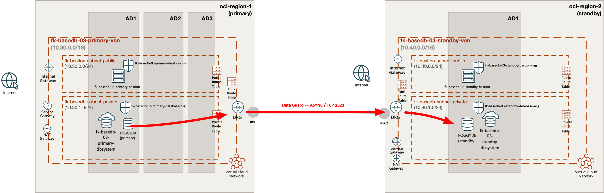
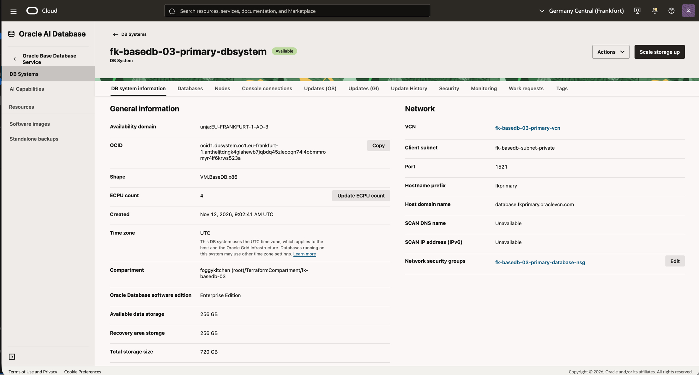
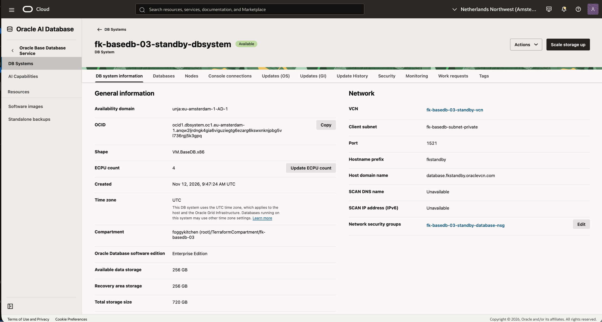
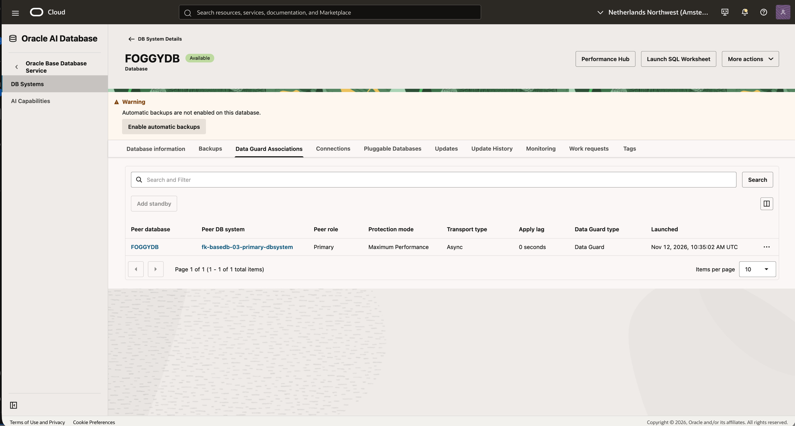
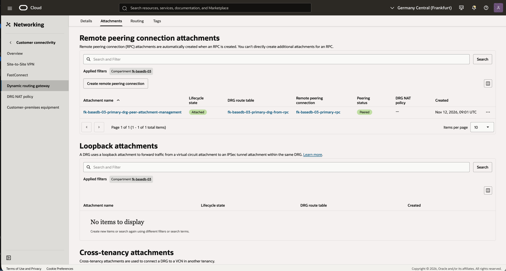
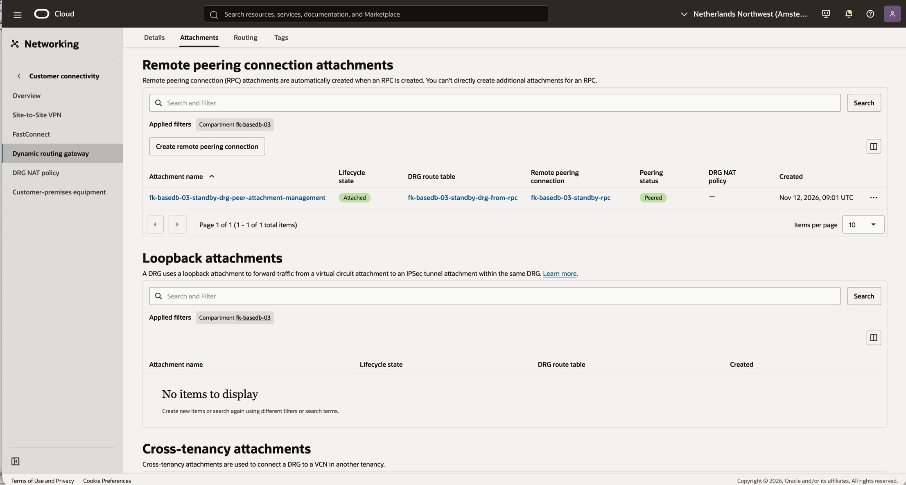
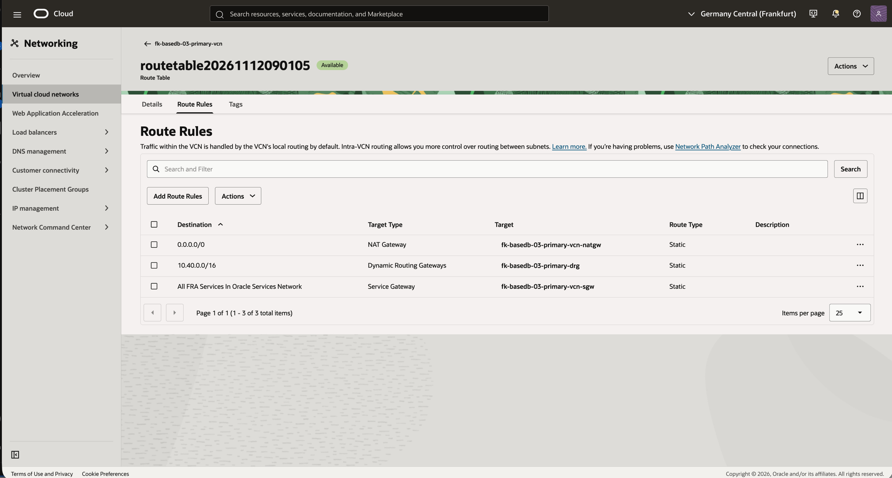
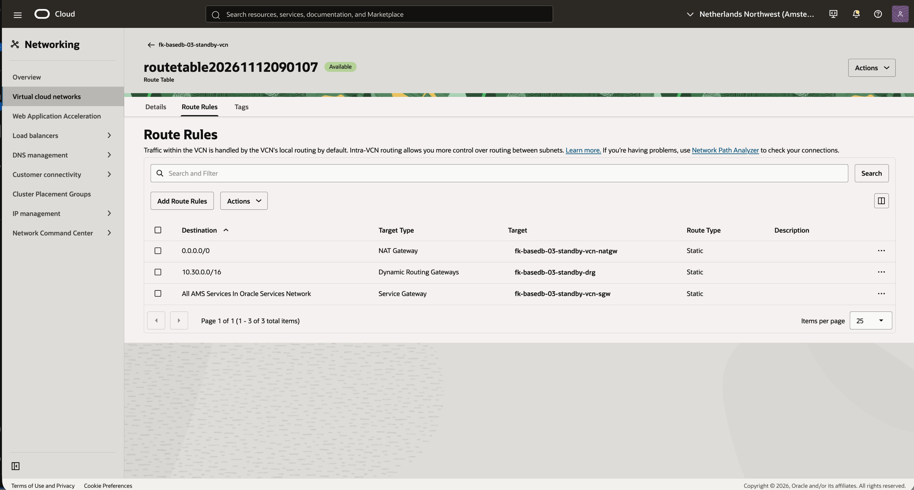

# Example 03: Cross-Region OCI BaseDB Data Guard

In this example, we deploy a **private OCI BaseDB primary and a physical Data Guard standby in two different OCI regions** using **Terraform/OpenTofu**. Each region has its own VCN, bastion and DRG, connected through Remote Peering Connections (RPCs).

The goal is to combine **cross-region private routing and Data Guard**, including the source-region association API, target-region discovery and bidirectional connectivity checks.

These examples are part of the [FoggyKitchen.com training ecosystem](https://foggykitchen.com/courses/). Each directory is an independent deployment; completing the previous example is not required.

---

## 🧭 Architecture Overview

Two different OCI regions are mandatory. Defaults are **eu-frankfurt-1** for primary and **eu-amsterdam-1** for standby. Both must be subscribed and have sufficient service quotas. Input validation rejects identical region names.



*Figure 1. Cross-region Data Guard architecture. Primary and standby use separate regional VCNs connected through DRGs and Remote Peering Connections.*

The red arrows illustrate asynchronous Data Guard redo transport from primary to standby over TCP/1521. Routing and NSG rules permit traffic in both directions. Each DRG Route Table symbol summarizes two tables: `from-vcn` forwards traffic to the remote region through the RPC attachment, while `from-rpc` forwards incoming traffic to the local VCN attachment. Availability-domain placement is illustrative and can be overridden through the example inputs.

Networking follows the [FoggyKitchen cross-region landing zone example](https://github.com/foggykitchen/foggykitchen-landing-zone-orchestrator/tree/main/examples/oci/networking/drg_cross_region/basic) and its [shared DRG/RPC pattern](https://github.com/foggykitchen/foggykitchen-landing-zone-orchestrator/tree/main/patterns/oci/drg_cross_region), used as the routing reference. This repository uses direct, pinned module composition and adds BaseDB, NSGs, compartments and validation hosts to that routing pattern.

| Region role | VCN | Bastion subnet | Database subnet |
|---|---|---|---|
| Primary | `10.30.0.0/16` | `10.30.0.0/24` | `10.30.1.0/24` |
| Standby | `10.40.0.0/16` | `10.40.0.0/24` | `10.40.1.0/24` |

Each region has its own VCN, Internet Gateway, NAT Gateway, Service Gateway, two subnets, two NSGs, OL9 bastion, DRG, VCN attachment and RPC. A single tenancy-wide compartment is created through the home-region provider.

### Resource names

Names follow examples 01/02 and the diagram:

| Resource | Primary region | Standby region |
|---|---|---|
| VCN | `fk-basedb-03-primary-vcn` | `fk-basedb-03-standby-vcn` |
| Bastion | `fk-basedb-03-primary-bastion` | `fk-basedb-03-standby-bastion` |
| Bastion NSG | `fk-basedb-03-primary-bastion-nsg` | `fk-basedb-03-standby-bastion-nsg` |
| Database NSG | `fk-basedb-03-primary-database-nsg` | `fk-basedb-03-standby-database-nsg` |
| DB system | `fk-basedb-03-primary-dbsystem` | `fk-basedb-03-standby-dbsystem` |
| DRG | `fk-basedb-03-primary-drg` | `fk-basedb-03-standby-drg` |
| RPC | `fk-basedb-03-primary-rpc` | `fk-basedb-03-standby-rpc` |

Each VCN has `fk-bastion-subnet-public` and `fk-basedb-subnet-private`. These names repeat in separate VCNs; CIDRs differ by region. The compartment is `fk-basedb-03`. Unlike example 02, the two databases use separate regional NSGs.

### Routing in both directions

- Primary public and private route tables send `10.40.0.0/16` to the primary DRG.
- Standby public and private route tables send `10.30.0.0/16` to the standby DRG.
- Each VCN attachment selects the explicit `from-vcn` DRG route table, whose remote-CIDR route points to the managed RPC attachment.
- Each RPC attachment selects the explicit `from-rpc` table, whose local-CIDR route points to the local VCN attachment.
- Standby RPC initiates peering to the primary RPC. Only one side supplies `peer_id` and `peer_region_name`.
- These tables use explicit static routes; the example does not rely on default DRG import distributions for connectivity. BaseDB creation waits for the composed DRG modules to finish.

### Provider roles

`oci` addresses the primary region. `oci.standby` addresses the standby region. `oci.home` addresses the tenancy home region for IAM compartment management. The standby BaseDB instance maps `oci = oci` for the source-region association API and `oci.target = oci.standby` for target database/node discovery. Changing both slots to the standby region would misroute the association request.

### Traffic and security

| Source | Destination | Protocol / port | Path |
|---|---|---|---|
| Trusted `admin_cidr` | Bastion | TCP/22 | Internet Gateway |
| Bastion | Database | TCP/22, TCP/1521 | Local VCN or DRG/RPC to the other region |
| Primary database subnet | Standby database subnet, and reverse | TCP/1521 | Both VCN and DRG route planes, via peered RPCs |
| Private database | Oracle Services Network | TCP/443 | Service Gateway |
| Private database | Other HTTPS destinations | TCP/443 | NAT Gateway |
| Bastion | Package repositories | TCP/443 | Internet Gateway |

All subnets attach an empty custom Security List and exclude the default Security List. NSGs own the workload permissions. Bastion SSH is limited to the required trusted administrator CIDR; `0.0.0.0/0` is rejected. Database SSH and listener access are limited to the example bastion subnet(s). Data Guard adds stateful TCP/1521 ingress and egress between database subnets. ICMP type 3/code 4 permits path MTU discovery. OCI-provided link-local DNS remains the resolver; cross-region tests use private IPs rather than assuming shared private DNS.

The Data Guard rules follow [Oracle BaseDB Data Guard prerequisites](https://docs.oracle.com/en/cloud/paas/base-database/data-guard/). NSG rules and routes are separate controls: an open TCP path does not prove database authentication or healthy redo apply.

---

## 🧩 Module Composition

| Module | Release | Purpose |
|---|---|---|
| `terraform-oci-fk-compartment` | v0.1.1 | Child compartment in the tenancy home region |
| `terraform-oci-fk-vcn` | v0.2.1 | VCN, subnets, route tables, IGW, NAT and SGW |
| `terraform-oci-fk-nsg` | v0.1.0 | Bastion, database and Data Guard security policy |
| `terraform-oci-fk-compute` | v0.2.2 | OL9 bastion, 1 OCPU and 8 GB RAM |
| `terraform-oci-fk-drg` | v0.4.1 | Two regional DRGs, RPCs and explicit routing |
| `terraform-oci-fk-basedb` | local `../..` | Database system and Data Guard creation paths |

The local BaseDB source supports development before its first release. External consumers should pin a published release when available. VCN v0.2.1, compartment v0.1.1 and DRG v0.4.1 support OCI `>= 6.0.0, < 10.0.0`; this example explicitly requires OCI `>= 9.12.1, < 10.0.0`. Local dependency overrides are no longer required. Initialization, validation and a read-only plan passed on 2026-11-12 using the published dependencies and OCI 9.12.1. No apply was run for this dependency verification.

---

## 📂 Files by Responsibility

```text
compartment.tf            Child compartment using the home-region provider
providers.tf              OCI regional providers and home-region IAM provider
versions.tf               OpenTofu and provider constraints
datasources.tf            Home-region and availability-domain discovery
locals.tf                 Explicit address plan and placement
network_primary.tf        VCN, subnets, gateways and VCN route tables
nsgs_primary.tf           Bastion and database NSG policy
compute_primary.tf        OL9 bastion / connectivity validation host
tls.tf                    Optional generated lab SSH keypair
dbsystem.tf               BaseDB primary module instance
dataguard.tf              BaseDB standby module instance
network_standby.tf        Second region VCN, subnets and gateways
nsgs_standby.tf           Second region NSG policy
compute_standby.tf        Second region bastion / validation host
drg_primary.tf            First region DRG, RPC, attachments and DRG routes
drg_standby.tf            Second region DRG, RPC peering and DRG routes
cloud-init.yaml           Install nmap-ncat on the validation host(s)
variables.tf              Authentication context, placement and database inputs
outputs.tf                IPs, IDs, connection strings and connectivity IDs
terraform.tfvars.example  Input template to copy and customize
tests/                    Offline mocked-provider topology tests
```

Module calls are separated by service and region. DRG and RPC resources are configured through the DRG module, keeping ownership inside that module. There is no all-in-one `main.tf` in this example.

---

## 📋 Requirements and Costs

Use **OpenTofu >= 1.11.0** and **OCI provider >= 9.12.1, < 10.0.0**. You need OCI API-key/profile or environment authentication, a tenancy, a parent compartment, permissions for IAM/network/compute/database resources, and service quotas. Install Git for module downloads and an SSH client plus `jq` for the runtime checks. The provider uses your local OCI credentials; do not put credentials in committed files. This example creates a new compartment but does not create the tenancy, subscribe regions or grant IAM permissions.

Choose a database version available for the requested shape/edition in both regions. Database ECPUs, shape, storage and license model are configurable. The default is one DB node per system, VM.BaseDB.x86, 4 ECPUs and 256 GB primary data storage. The database OS is controlled by BaseDB; OL9 settings apply to the bastion only.

This example selects **Enterprise Edition**, matching the successful same-region Data Guard deployment in example 02. Confirm licensing and capacity for both primary and standby systems. Active Data Guard is disabled.

BaseDB, bastion compute, NAT and storage incur charges. Cross-region traffic may also incur charges. The compartment is retained on destroy (`enable_delete = false`). Automatic primary backups are disabled by default; SGW routing is available for Oracle services when backup policy is configured separately.

### Current BaseDB provisioning boundary

Both primary and standby use `compute_model = "ECPU"` and `compute_count = var.database_ecpus`, with a default of 4 ECPUs per system. The shared BaseDB module explicitly selects LVM for the primary, validates the ECPU/shape combination, and trims SSH public-key whitespace to avoid the post-apply drift seen during example 01. Data Guard creates the standby and inherits the primary database version and SSH keys; do not pass primary-only inputs to the standby module.

The input template selects **26ai `23.26.4.0.0`**. Example 03 successfully deployed this version with Enterprise Edition and VM.BaseDB.x86 in Frankfurt and Amsterdam on **2026-11-12**. Confirm availability and capacity in both selected regions before a new deployment; the recorded results describe this specific lab run.

---

## ⚙️ Configuration

Copy [terraform.tfvars.example](terraform.tfvars.example) and replace all placeholder values. The example exposes these inputs; additional BaseDB module settings are fixed in the `.tf` files.

| Input | Default | Purpose |
|---|---|---|
| `tenancy_ocid` | **Required** | Tenancy OCID for AD and home-region discovery. |
| `parent_compartment_id` | **Required** | Existing parent compartment or tenancy OCID; a child compartment is created by this example. |
| `name_prefix` | `"fk-basedb-03"` | Unique resource name prefix and child compartment name. |
| `primary_region` | `"eu-frankfurt-1"` | Region in which the primary is created. |
| `primary_availability_domain` | `null` | Optional primary AD override; defaults to the first discovered AD. |
| `admin_cidr` | **Required** | Trusted public IPv4 CIDR allowed to SSH to the bastion, for example your public IP /32. |
| `database_version` | **Required** | Explicit BaseDB version supported by the selected region(s), edition and shape. |
| `admin_password` | **Required** | Database SYS password supplied securely, shared by primary and standby. |
| `ssh_public_keys` | `[]` | Optional public keys; omit to generate one RSA-4096 lab key shared by the primary and both bastions. Standby inherits it. |
| `database_shape` | `"VM.BaseDB.x86"` | BaseDB VM shape supported in the selected region(s). |
| `database_ecpus` | `4` | ECPUs per database system, at least 4 and in multiples of 4. |
| `database_storage_gb` | `256` | Primary data storage GB; standby storage is created by Data Guard. |
| `license_model` | `"LICENSE_INCLUDED"` | Oracle database license model; review costs and BYOL entitlement. |
| `standby_availability_domain` | `null` | Optional standby AD override; defaults to the first AD in the standby region. |
| `standby_region` | `"eu-amsterdam-1"` | A second subscribed OCI region; must differ from primary_region. |

The address plan is defined in [locals.tf](locals.tf). Choose a unique `name_prefix` for each deployment. All three OCI providers use `tenancy_ocid` and optional `user_ocid`, `fingerprint`, and `private_key_path` inputs (default `null`), as in examples 01/02. Omit the optional inputs when using OCI profile/environment authentication. Keep credential values in ignored local files or the environment.

---

## 🚀 Deployment Steps

From the repository root:

```sh
cd examples/03_cross_region_data_guard
cp terraform.tfvars.example terraform.tfvars
# Set tenancy_ocid, parent_compartment_id, your trusted admin_cidr,
# a region-supported database_version, and optionally your SSH public key(s).
# Supply TF_VAR_admin_password securely without committing the password.
tofu init
tofu validate
tofu plan -out=example.tfplan
# Review all billable resources and network/security changes.
tofu apply example.tfplan
```

Run all remaining commands from this example directory. Supply `TF_VAR_admin_password` through your secret manager or a secure local environment before `plan`, `apply` and `destroy`.

No pre-existing subnet, NSG, VCN or deployment compartment OCIDs are required. Protect state and plans because they can contain the SYS password and generated private SSH key. Bastion cloud-init installs `nmap-ncat` from OL9 BaseOS/AppStream with limited retries. Wait for cloud-init before running listener checks.

---

## 📤 Outputs

After a successful apply, use `tofu output` to inspect the deployment:

| Output | Purpose |
|---|---|
| `ssh_private_key_pem` | Sensitive generated private key; null when public keys are supplied. Stored in state. |
| `compartment_id` | Child compartment OCID. |
| `primary_vcn_id` | Primary VCN OCID. |
| `primary_bastion_public_ip` | Primary bastion public IP for SSH access. |
| `standby_vcn_id` | Standby VCN OCID. |
| `standby_bastion_public_ip` | Standby bastion public IP for SSH access. |
| `primary_db_system_id` | Primary DB system OCID. |
| `primary_database_id` | Primary database OCID. |
| `primary_private_ips` | Primary database node private IP addresses. |
| `primary_connection_strings` | Primary database connection strings reported by OCI. |
| `standby_db_system_id` | Standby DB system OCID. |
| `standby_database_id` | Standby database OCID. |
| `standby_private_ips` | Standby database node private IP addresses. |
| `standby_connection_strings` | Standby database connection strings reported by OCI. |
| `data_guard_association_id` | Source-side Data Guard association OCID. |
| `primary_drg_id` | Primary DRG OCID. |
| `primary_drg_route_table_ids` | Primary map of DRG route table names to OCIDs. |
| `primary_remote_peering_connection_ids` | Primary map of RPC names to OCIDs. |
| `standby_drg_id` | Standby DRG OCID. |
| `standby_drg_route_table_ids` | Standby map of DRG route table names to OCIDs. |
| `standby_remote_peering_connection_ids` | Standby map of RPC names to OCIDs. |

---

## 🖥️ OCI Console and Runtime Verification

Live deployment and runtime checks completed on **2026-11-12**, using OCI **9.12.1**, local dependency overrides, and Oracle AI Database **26ai Enterprise Edition 23.26.4.0.0**. The environment was subsequently destroyed after verification and screenshots; the empty compartment was retained. Primary ran in Frankfurt AD-3 and standby in Amsterdam AD-1. Both systems used **VM.BaseDB.x86, 4 ECPUs and 256 GB data storage**; the console reported 720 GB total storage per system, including recovery and system volumes.

### Recorded test results

| Check | Result | Evidence |
|---|---|---|
| Apply | PASS | Initial plan: 74 additions. After a partial first attempt, the resumed apply added the remaining 50 resources, with 0 changes and 0 destroys. |
| Lifecycle | PASS | Both DB systems, databases and Data Guard associations AVAILABLE. |
| Data Guard | PASS | PRIMARY/STANDBY, ASYNC, MAXIMUM_PERFORMANCE; Active Data Guard disabled. |
| Remote peering | PASS | Both RPCs PEERED; RPC attachments use the regional from-rpc route tables. |
| VCN routes | PASS | Frankfurt routes 10.40.0.0/16 through its DRG; Amsterdam routes 10.30.0.0/16 through its DRG. |
| Bastion initialization | PASS | Both bastions report cloud-init status: done. |
| Private listeners | PASS | TCP/1521 reachable from each bastion to each database: all four paths passed, including both cross-region directions. |
| SSH through primary bastion | PASS | Primary returned fkprimary; cross-region standby returned fkstandby. |
| SQL version | PASS | Both nodes report 26ai Enterprise Edition 23.26.4.0.0. |
| Primary role and PDB | PASS | FOGGYDB PRIMARY / READ WRITE; FKPDB1 READ WRITE. |
| Standby role and PDB | PASS | FOGGYDB PHYSICAL STANDBY / MOUNTED; FKPDB1 MOUNTED. |
| SQL transport/apply lag | PASS | Both +00 00:00:00 at 11:16:32 UTC; source datum time 11:16:31 UTC. |
| Redo receive/apply | PASS | RFS RECEIVING and MRP0 APPLYING_LOG, thread 1, sequence 8. |
| Post-apply plan | PASS | No changes. Your infrastructure matches the configuration. |
| Offline validation | PASS | tofu validate and all 4 example mock tests passed before apply. |

The first apply returned transient-looking 404 errors for DRG/VCN creation and empty image discovery after creating the compartment. A later read confirmed Frankfurt and Amsterdam subscriptions were READY and images were available in both regions; the resumed apply succeeded without configuration changes. Compartment propagation is a possible cause, not a confirmed diagnosis. The example's region-subscription data source filters for `is_home_region = true`; its output is not the full subscription list.

SQL and connectivity checks ran on **2026-11-12, 11:16:23–11:16:32 UTC**, using SSH through the bastions and local OS authentication (`sudo -iu oracle sqlplus -s / as sysdba`). These checks did not test password-based application login, switchover, failover or a dedicated test transaction. Zero lag is a point-in-time observation, not a sustained-load result. The console screenshot also reports apply lag of 0 seconds; the API reads during deployment returned no lag values.

### Practical lessons from examples 01/02

- Use a strong shared SYS password. The successful lab passwords had 12–30 characters and at least two uppercase letters, lowercase letters, digits and special characters. The module validates length; OCI performs the remaining complexity checks.
- Wait for cloud-init before listener checks. Verify SSH to both private nodes through a bastion, TCP/1521 in both regional directions, database roles and replication lag separately. Local OS-authenticated SQL does not prove password-based application login.
- The role, PDB and lag checks from example 02 were repeated for example 03; its independently measured results are recorded above. Switchover, failover and a dedicated test transaction remain outside the recorded checks.
- Work Request percentages are not linear time estimates. Primary provisioning remained at 5% for about 26 minutes. Standby appeared on the DB Systems list several minutes after Data Guard creation began. The parent Data Guard operation and nested DB System creation had different progress percentages; both systems briefly entered `UPDATING` during configuration.
- After apply, verify both systems, databases and associations are `AVAILABLE`, then run `tofu plan` and expect no changes. Example 02 passed that check after the shared SSH whitespace fix.

### Measured deployment duration

| Operation | Measured in example 03 |
|---|---|
| Primary creation | 41m14s. |
| Standby / Data Guard creation | 1h7m49s, after primary. |
| Resumed apply | Approximately 1h50m, including remaining networking; excludes the first attempt and troubleshooting interval. |
| Standby termination | Approximately 24 minutes, observed through target-region API polling. |
| Primary deletion on retry | 16m50s. |
| Final destroy retry | 26m03s, including remaining network cleanup. |
| Complete cleanup elapsed time | Approximately 1h01m29s (11:19:41–12:21:10 UTC), including the failed first attempt, standby termination, waiting and the final retry. |

These are observations from one deployment, not service guarantees. Reserve 2–3 hours for a new apply. The primary Work Request remained at 5% before advancing to 25%; standby system creation reached 100% while the parent Data Guard operation still showed 25%. Work Request percentages do not provide a linear time estimate.

### 1. Access and private listener

```sh
umask 077
tofu output -raw ssh_private_key_pem > primary_ssh.pem
ssh_key="$PWD/primary_ssh.pem" # With supplied public keys, use your matching private key instead.
bastion_ip=$(tofu output -raw primary_bastion_public_ip)
primary_db_ip=$(tofu output -json primary_private_ips | jq -r '.[0]')
ssh -i "$ssh_key" opc@"$bastion_ip" 'sudo cloud-init status --wait'
ssh -i "$ssh_key" opc@"$bastion_ip" "nc -vz '$primary_db_ip' 1521"
ssh -i "$ssh_key" -J opc@"$bastion_ip" opc@"$primary_db_ip" hostname
```

A successful `nc` check reports port 1521 open; successful SSH prints the database host name. Keep the private key locally; do not copy it onto the bastion. With multiple local identities, configure the same `IdentityFile` for the jump host in `~/.ssh/config`. If cloud-init fails, inspect its logs and repository access before assuming the network is healthy.

### 2. Standby listener

```sh
standby_db_ip=$(tofu output -json standby_private_ips | jq -r '.[0]')
ssh -i "$ssh_key" opc@"$bastion_ip" "nc -vz '$standby_db_ip' 1521"
```

This check starts on the primary-region bastion and traverses DRG/RPC into the standby VCN. Test the return direction independently:

```sh
standby_bastion_ip=$(tofu output -raw standby_bastion_public_ip)
ssh -i "$ssh_key" opc@"$standby_bastion_ip" 'sudo cloud-init status --wait'
ssh -i "$ssh_key" opc@"$standby_bastion_ip" "nc -vz '$primary_db_ip' 1521"
```

In OCI Console, check both RPCs report `PEERED`, both VCN attachments select `from-vcn`, and both RPC attachments select `from-rpc`. Inspect remote VCN routes as well as DRG route rules. Region subscription alone does not create a peered network.

### 3. Database checks and recorded SQL results

In OCI Console, verify the DB system and database lifecycle states are `AVAILABLE`. Connect through the bastion to a DB node, switch to the `oracle` OS account, select the correct Oracle environment, and open SQL*Plus with local SYSDBA authentication:

```sql
select banner_full from v$version;
select name, database_role, open_mode from v$database;
select name, open_mode from v$pdbs;
-- On standby, also inspect current replication lag:
select name, value, unit, time_computed, datum_time from v$dataguard_stats
where name in ('transport lag', 'apply lag');
select process, status, thread#, sequence# from v$managed_standby
where process like 'MRP%' or process = 'RFS';
```

Recorded output from the live checks on **2026-11-12** (presented as text; no SQL screenshot is required):

```text
Primary:
FOGGYDB   PRIMARY           READ WRITE
PDB$SEED                   READ ONLY
FKPDB1                     READ WRITE

Standby:
FOGGYDB   PHYSICAL STANDBY  MOUNTED
PDB$SEED                   MOUNTED
FKPDB1                     MOUNTED

Standby replication statistics:
transport lag  +00 00:00:00
apply lag      +00 00:00:00
TIME_COMPUTED  11/12/2026 11:16:32
DATUM_TIME     11/12/2026 11:16:31

PROCESS  STATUS        THREAD#  SEQUENCE#
RFS      IDLE          1        0
RFS      RECEIVING     1        8
MRP0     APPLYING_LOG  1        8
```

The primary should report `PRIMARY` and `READ WRITE`. A physical standby with Active Data Guard disabled is normally `PHYSICAL STANDBY` / `MOUNTED`; do not require read-only SQL access to its PDB. Check both Data Guard associations, transport/apply lag and synchronization status in OCI. After a switchover, review observed roles before any new OpenTofu plan; the module `role` input is not an operational switchover command.

For application authentication, use SQLcl/SQL*Plus and the reported connection string, supplying the password interactively. Private IP reachability, SQL login and Data Guard apply are separate checks.

---

## 📸 OCI Console Screenshots

Captured from the example 03 deployment on **2026-11-12**. Screenshots document console state; SQL and connectivity results are recorded above.



*Figure 2. Primary in Frankfurt AD-3: Available, VM.BaseDB.x86, 4 ECPUs, Enterprise Edition and 256 GB data storage.*



*Figure 3. Standby in Amsterdam AD-1 with matching shape, ECPU count and edition, in Available state.*



*Figure 4. Standby-side Data Guard view: peer role Primary, Maximum Performance, Async transport and apply lag of 0 seconds. The backup warning reflects this lab's disabled automatic backups.*



*Figure 5. Frankfurt RPC attachment: Attached and Peered, using the primary from-rpc DRG route table.*



*Figure 6. Amsterdam RPC attachment: Attached and Peered, using the standby from-rpc DRG route table.*



*Figure 7. Frankfurt private routes: remote 10.40.0.0/16 through the primary DRG, default route through NAT and regional Oracle services through SGW.*



*Figure 8. Amsterdam private routes: remote 10.30.0.0/16 through the standby DRG, default route through NAT and regional Oracle services through SGW.*

---

## ✅ Offline Validation

```sh
tofu init -backend=false
tofu validate
tofu test
```

Offline validation completed on **2026-11-09** with OCI **9.12.1** and TLS **4.4.2**, using local dependency overrides at the time: initialization, `tofu validate` and recursive formatting checks succeeded; **4 tests passed, 0 failed**. Tests cover cross-region composition/provider discovery and DRG/RPC outputs, rejection of public SSH, rejection of identical regions, and generation of the shared lab SSH key.

Tests mock OCI and TLS providers and do not create infrastructure. They do not prove OCI regional capacity, actual peering, network connectivity, licensing or successful database provisioning.

---

## 🧹 Cleanup

```sh
tofu plan -destroy
tofu destroy
```

Destroy removes example networking, compute and databases; lab data is deleted. The association is configured with `delete_standby_db_home_on_delete = true`, but the **2026-11-12 cross-region cleanup required an explicit standby termination in Amsterdam**: the provider reported association destruction complete after 1 second while the standby DB system, database and association remained AVAILABLE. The first destroy consequently failed: standby NSG/subnet deletion was blocked by its VNIC, and OCI refused to terminate the primary while its Data Guard standby still existed. The standby's exact DB system OCID was checked against the saved destroy plan and its compartment/name verified before submitting termination through the standby-region OCI API, which returned TERMINATING. This is an observed cleanup limitation; the provider's root cause has not been established.

The child compartment remains in OCI because `enable_delete = false`; account for it before a subsequent deployment. Copy required data before cleanup. After destroy, check that state has no managed resources and inspect **both regions** for remaining DB systems, instances, VCNs, block/boot volumes and backups. Do not treat association removal from state as proof that the remote DB system has been deleted. If this behavior recurs, verify the exact standby system from the destroy plan, terminate it in the target region, and rerun a fresh destroy plan for any remaining managed resources after termination completes.

### Recorded cleanup results

The final saved destroy plan completed on **2026-11-12 at 12:21:10 UTC**: **0 added, 0 changed, 46 destroyed**, removing the resources left after the first attempt. The resulting OpenTofu state contains **0 managed resource instances**. The compartment resource is removed from state but its OCI compartment is intentionally retained.

An independent, paginated OCI inventory completed at **12:41:46 UTC**, scoped to the example's compartment in both Frankfurt and Amsterdam. It found **0 non-terminated/non-deleted** DB systems, compute instances, VCNs, DRGs, RPCs, subnets, NSGs, NAT gateways, Internet Gateways, Service Gateways, block volumes, boot volumes, volume backups, boot-volume backups and database backups in each region. The retained `fk-basedb-03` compartment was ACTIVE. Terminated resource records may remain visible temporarily in OCI history.

---

## 🎓 Learning Outcomes

After working through this example, you can:

- Compose two regional networks with explicit VCN and DRG routes over RPC peering.
- Map the primary and target OCI providers correctly for a cross-region standby.
- Verify both network directions before checking Data Guard replication health.

---

## 🌐 Learn More

Visit [FoggyKitchen.com](https://foggykitchen.com/) for OCI, multicloud and Terraform/OpenTofu learning resources.

[Previous: same-region Data Guard](../02_same_region_data_guard/README.md)

[All BaseDB examples](../README.md) · [Module reference](../../README.md) · [Support](../../SUPPORT.md)

---

## 🪪 License

Licensed under the **Universal Permissive License (UPL), Version 1.0**.
See [LICENSE](../../LICENSE) for details.

---

© 2026 [FoggyKitchen.com](https://foggykitchen.com) - Cloud. Code. Clarity.
