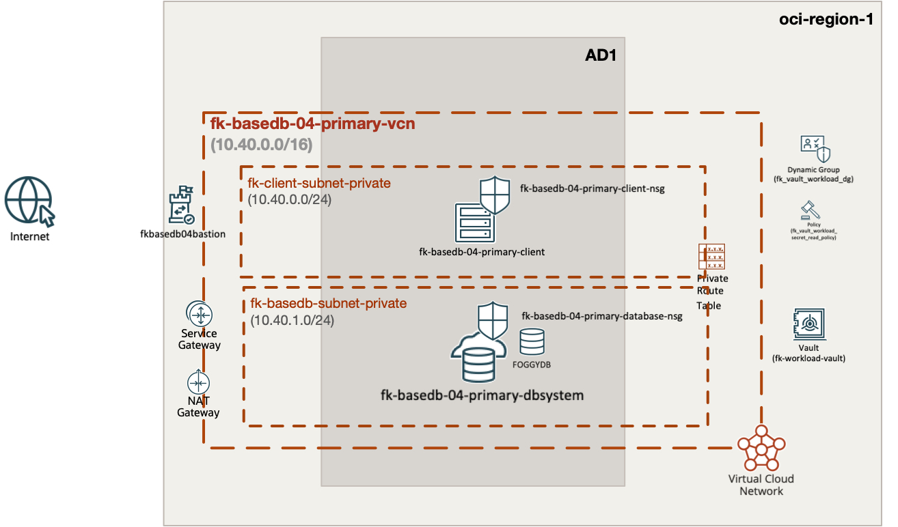

# 04 — Single Primary with an Existing Vault and Customer-Managed Key

Create a private BaseDB primary using an **existing OCI Vault and AES-256 KMS key**. This follows [ADB lesson 7 at v2.0.0](https://github.com/foggykitchen/terraform-oci-fk-adb/tree/v2.0.0/training/lesson7_adb_with_oci_vault): the caller supplies `vault_id` and `kms_key_id`, and the lab composes database, networking and IAM resources. That ADB lesson neither creates nor imports a Vault and does not retrieve a Vault secret.

A secret containing an ADB password is not a TDE master key. This example never reads secret contents and does not reuse the ADB password. Supply the BaseDB SYS password separately through `TF_VAR_admin_password`.

## Architecture



- A dedicated lab compartment and VCN with two private subnets: client and Bastion endpoint `10.40.0.0/24`, and database `10.40.1.0/24`.
- An Oracle Linux 9 client with no public IP, reached through OCI Bastion Service from `admin_cidr`. No Internet Gateway; NAT and Service Gateway provide outbound connectivity.
- The client subnet security list allows TCP/22 egress within that subnet for the Bastion endpoint. This additive rule also applies to the client VNIC. Client NSG ingress allows SSH only from the endpoint's /32. Database NSG ingress allows TCP/22 and TCP/1521 only from the client NSG.
- One VM.BaseDB.x86 primary, 4 ECPUs, 256 GB data storage, Standard Edition and LVM by default.
- Read-only Vault/key metadata lookups in `primary_region`; no Vault, key, key-version or secret resources in this state.
- An optional lab-owned dynamic group and scoped IAM policy in the tenancy home region.

| Module | Source |
|---|---|
| BaseDB | Local `../..` checkout |
| Compartment | v0.2.0 |
| VCN | v0.3.0 |
| NSG | v0.2.0 |
| Compute | v0.3.0 |
| Policy | v0.2.0 |
| Bastion Service | v0.2.0 |

If the shared Vault is managed using [terraform-oci-fk-vault v0.2.0](https://github.com/foggykitchen/terraform-oci-fk-vault/tree/v0.2.0), consume its `vault_id` and `key_ids` outputs. Any import into that module belongs in its separate shared-resource state, not this lab. Do not assign two states ownership of the same Vault/key.

## Existing key and IAM prerequisites

Use OpenTofu >= 1.11.0 and OCI >= 9.12.1, < 10.0.0. The Vault must be ACTIVE in `primary_region`. The key must belong to that Vault, be ENABLED and use AES-256 with HSM or SOFTWARE protection. Metadata data sources check those properties during a real plan. The deployment identity needs read access to the existing Vault/key, in addition to normal database/network permissions and IAM administration when `create_vault_iam = true`.

By default, `iam.tf` creates a uniquely named dynamic group matching resources in the dedicated lab compartment. Its policy grants `use vaults` for the selected Vault and `manage keys` for the selected key, constrained by compartment and resource OCID. There are no secret or secret-bundle grants. Unlike the ADB lesson's `use keys`, BaseDB needs key-management permissions; see [BaseDB key prerequisites](https://docs.oracle.com/en/cloud/paas/base-database/guide/key-about.html), [DB-node key access](https://docs.oracle.com/en-us/iaas/Content/KeyManagement/Tasks/assigningkeys.htm), and [supported Vault policy conditions](https://docs.oracle.com/en-us/iaas/Content/Identity/policyreference/keypolicyreference.htm).

The group covers the lab compartment, not only one resource OCID. Keep unrelated workloads out of this compartment. A dedicated existing BaseDB key in the shared Vault is preferable to reusing the key that encrypts unrelated secrets: database operations may create key versions, and `manage keys` is broader than encrypt/decrypt. This configuration does not itself rotate or schedule deletion of the shared key.

Set `create_vault_iam = false` only when equivalent IAM for the lab compartment is already administered externally. No existing policies are adopted or edited. Do not switch this flag off after deployment unless equivalent permissions are already effective: doing so plans deletion of the lab-owned IAM resources. Separate instances of policy v0.2.0 create the dynamic group first and then bind policy statements to its OCID. This establishes an explicit dependency and avoids creating a name-based policy before the group exists. A `moved` block preserves the existing dynamic group in state. `depends_on` orders policy creation before BaseDB, but does not guarantee IAM propagation has completed. Confirm effective permissions before provisioning; a successful static validation cannot establish that.

## Files and inputs

The private-access layout follows the [orchestrator BaseDB private-access example at v2.2.1](https://github.com/foggykitchen/foggykitchen-landing-zone-orchestrator/blob/v2.2.1/examples/oci/database/basedb/private_access/basic/README.md). `bastion.tf` creates the service and an optional temporary session. The service is separate from the session so its endpoint IP can restrict client ingress without a dependency cycle. `vault.tf` reads the existing Vault/key, `iam.tf` composes the policy module, and `dbsystem.tf` passes the CMK IDs into the BaseDB module.

| Additional input | Default | Meaning |
|---|---|---|
| `vault_id` | Required | Existing Vault OCID in the primary region |
| `kms_key_id` | Required | Existing AES-256 key OCID in that Vault |
| `kms_key_version_id` | `null` | Optional existing key version for the CDB |
| `create_vault_iam` | `true` | Create lab-owned dynamic group and policy |
| `create_session` | `false` | Create Managed SSH session after plugin readiness is verified |
| `session_ttl_in_seconds` | `3600` | Temporary session lifetime: 1800–10800 seconds |
| `admin_cidr` | Required | Trusted public IPv4 CIDR in the Bastion Service allow list; /0 forbidden |

The remaining inputs match [example 01](../01_single_primary/README.md), with `name_prefix = "fk-basedb-04"` and VCN CIDR `10.40.0.0/16`. Use a unique prefix and non-overlapping CIDRs when deploying multiple labs.

```sh
cp terraform.tfvars.example terraform.tfvars
# Replace placeholders with your tenancy, existing Vault/key and trusted admin CIDR.
# Supply TF_VAR_admin_password securely through the environment.
tofu init -backend=false
tofu validate
tofu plan -out=example.tfplan
```

Review the plan before an explicitly approved `tofu apply example.tfplan`. It must contain no managed Vault, key or secret resources. BaseDB compute/storage, the private client and NAT incur charges; the existing Vault/key retain their existing lifecycle and costs. With no supplied SSH keys the lab generates a private key in state; protect state and plans.

The root module's nested CMK fields are `ForceNew` in the provider. Changing the Vault, key or explicit key version may replace the primary system. This example is not an in-place migration or rotation workflow.

## Private access through OCI Bastion Service

The access path is `administrator → OCI Bastion Service → private client → private BaseDB`. There is no public SSH address on the client or database. The Bastion endpoint shares the client subnet. Its security list supplies SSH egress because the service endpoint is not attached to the client NSG. Security-list and NSG rules are additive: the shared list also permits client SSH egress within that subnet, but grants no ingress. Client SSH ingress remains restricted to the endpoint /32 in its NSG. Default security lists are excluded from both subnets. HTTPS egress allows client updates and agent communication through NAT/Service Gateway.

1. Deploy only after approval, initially keeping `create_session = false`. The compute configuration requests the Oracle Cloud Agent **Bastion** plugin to be ENABLED. In OCI Console, open the client instance's Oracle Cloud Agent tab and wait until that plugin actually reports **RUNNING**. ENABLED is desired configuration, not readiness. The deployment identity also needs Bastion/session permissions; see [OCI Bastion prerequisites](https://docs.oracle.com/en-us/iaas/Content/Bastion/Tasks/managingbastions.htm).
2. Once RUNNING, set `create_session = true`, review a fresh plan and apply it only with deployment approval. This example uses explicit staging instead of the orchestrator's fixed 600-second wait: a delay alone cannot prove plugin readiness. The session targets the private client as `opc` using the first supplied SSH key (or the generated lab key).
3. Read `tofu output -raw session_ssh_command`. Substitute your matching local private-key path in the OCI-generated command and run it from the allowed public CIDR. If a lab key was generated, save the sensitive `ssh_private_key_pem` output to a local file with mode 600. Do not commit it or copy it onto the client.
4. On the client, test `nc -zv <primary-private-ip> 1521`. For SQL/DB-host checks, use SSH ProxyJump through the client with your key kept locally, or an installed Oracle SQL client and the private connection string. Do not use direct public SSH or enable unrestricted agent forwarding. Confirm `v$database` reports PRIMARY / READ WRITE, the PDB is open, and inspect `v$encryption_wallet`.

Sessions expire after their configured TTL (one hour by default, at most three hours); expiry does not delete the service, client or database. Inspect a refreshed plan before recreating an expired session. With `create_session = false`, session outputs are null; use `bastion_id`, `primary_client_id` and `primary_client_private_ip` to identify the access resources. Setting the flag back to false plans deletion of the managed session.

## Runtime verification after an approved deployment

1. Confirm the DB system and database are AVAILABLE. Record the database OCID and inspect the database's encryption fields using the existing OCI authentication:

   ```sh
   DATABASE_ID=$(tofu output -raw primary_database_id)
   oci db database get --database-id "$DATABASE_ID" --region "$PRIMARY_REGION" \
     --query 'data.{state:"lifecycle-state",key:"kms-key-id",vault:"vault-id",version:"kms-key-version-id"}'
   ```

   Set `PRIMARY_REGION` to the configured region. Compare the returned key/Vault with the chosen inputs. `cmk_vault_id`, `cmk_key_id` and `cmk_requested_key_version_id` outputs describe the selected inputs; they are not proof that the database uses them. If the API omits a field, inspect the database Encryption section in OCI Console rather than inferring success from configuration.

2. Perform the private-access and SQL checks above. Inspect the database Encryption section and record the evidence without passwords or key material.
3. Run `tofu plan` again and inspect any differences. If an explicit CDB key version was supplied, compare it separately. Oracle may use a different/new version for the PDB; see [BaseDB encryption-key behavior](https://docs.oracle.com/en/cloud/paas/base-database/guide/key-about.html).

## Cleanup and shared resources

After explicit cleanup approval, review `tofu plan -destroy` and run the approved destroy. It removes the lab database, private client, Bastion session/service, network and lab-owned IAM resources. The child compartment is retained (`enable_delete = false`). Existing Vault/key metadata entries are data sources, not managed resources: the lab does not schedule Vault/key deletion or delete the existing ADB secret.

Keep the key available for any retained database backups and other consumers. Verify the shared Vault/key remain ACTIVE/ENABLED and that unrelated ADB resources still have their own IAM access. No key disable/delete/rotation or secret-content reads are part of this lab's cleanup.

## Validation status

`tofu init -backend=false`, `tofu validate` and `tofu fmt -check -recursive` passed with OpenTofu 1.11.6 and OCI provider 9.15.0. These are configuration checks; no real-input plan or OCI metadata readiness check was performed. A live apply on 2026-11-27 created networking, IAM, Bastion Service and the private client, whose Bastion plugin reported RUNNING. The DB System failed after approximately 37.5 minutes with DCS-10353 / DBT-16015 during KMS key validation. KMS audit recorded a GetKey request by the DB System principal returning HTTP 404 at 10:46:55 UTC; the same key metadata was readable by the deployment identity. This points to authorization as a leading cause but does not prove the exact IAM failure. The original apply log also showed the name-based policy completing before dynamic-group creation; the OCID/dependency correction addresses that ordering hazard and is not yet live-verified. SQL verification and successful CMK assignment remain pending. No destroy was performed. This scenario does not test cross-region key replication or Data Guard with CMK.

## License

Universal Permissive License (UPL), Version 1.0. See [LICENSE](../../LICENSE).

---

© 2026 [FoggyKitchen.com](https://foggykitchen.com) - Cloud. Code. Clarity.
